# Procedimientos almacenados y triggers en SonoraDB

Sesión 1: Stored Procedures · Sesión 2: Triggers · Ejercicios de refuerzo

- Autor: Álvaro García-Quismondo Lizana
- Estudios: Máster en Inteligencia Artificial y Big Data · Tajamar
- Fecha: 13 de octubre de 2026
- Entorno: SQL Server 2022 (16.0) · SSMS · SonoraDB

## Contenido de la entrega

- `Procedimientos_Triggers_Sonora.pdf`: este mismo documento en PDF.
- `sql/sesion1_procedures/`: un script por ejercicio de la Sesión 1, más `00_prerrequisitos_teoria.sql`.
- `sql/sesion2_triggers/`: un script por ejercicio de la Sesión 2.
- `img/`: capturas de la ejecución en SSMS.

## 1. Introducción

Este documento recoge la resolución de los ejercicios de refuerzo de dos sesiones sobre la base de datos SonoraDB, la plataforma de streaming musical que usamos en clase: la Sesión 1, dedicada a los procedimientos almacenados, y la Sesión 2, dedicada a los triggers.

Los ejercicios se ejecutaron en una instancia local de SQL Server 2022 (16.0.1000.6) desde SQL Server Management Studio, siempre sobre SonoraDB. Antes de cada sesión ejecuté el script del punto de partida del enunciado, que deja la base con 43 reproducciones, 10 usuarios, 15 canciones y 9 artistas, y que en la Sesión 2 retira además los triggers de la teoría.

Para cada ejercicio se incluye el código, la captura de la ejecución en SSMS y la respuesta a las preguntas del enunciado. Los scripts completos están en la carpeta sql/, uno por ejercicio, y las capturas en img/. En el código del documento se han quitado los comentarios largos con las respuestas, que se desarrollan en el texto.

Los subrayados rojos que aparecen en algunas capturas son de IntelliSense, que tenía la caché sin actualizar tras crear tablas nuevas. No corresponden a errores de ejecución: los errores reales son los que aparecen en la pestaña Mensajes.

## 2. Sesión 1. Procedimientos almacenados

### 2.1 Punto de partida y objetos de la teoría

Varios ejercicios reutilizan objetos creados en la teoría: dbo.usp_top_canciones en la versión del Ejemplo 4, dbo.usp_cifras_periodo del Ejemplo 5, la tabla dbo.resumen_diario y la tabla de log dbo.log_cargas. Para no depender de haber ejecutado todos los ejemplos, preparé un script que crea los procedimientos con CREATE OR ALTER y las tablas solo si no existen. Se ejecuta después del punto de partida.

Script: `sql/sesion1_procedures/00_prerrequisitos_teoria.sql`

```sql
USE SonoraDB;
GO

-- usp_top_canciones (versión del Ejemplo 4) -> Ejercicio 3
CREATE OR ALTER PROCEDURE dbo.usp_top_canciones
    @desde  date,
    @hasta  date,
    @top    int           = 3,
    @plan   nvarchar(20)  = NULL
AS
BEGIN
    SET NOCOUNT ON;

    SELECT TOP (@top) c.titulo, a.nombre AS artista, COUNT(*) AS reproducciones
    FROM dbo.reproducciones AS r
    JOIN dbo.canciones AS c ON c.cancion_id = r.cancion_id
    JOIN dbo.artistas  AS a ON a.artista_id = c.artista_id
    JOIN dbo.usuarios  AS u ON u.usuario_id = r.usuario_id
    WHERE r.tipo_contenido = N'Canción'
      AND r.segundos_escuchados >= 30
      AND r.fecha_hora >= @desde
      AND r.fecha_hora <  @hasta
      AND (@plan IS NULL OR u.plan_suscripcion = @plan)
    GROUP BY c.titulo, a.nombre
    ORDER BY reproducciones DESC, c.titulo;
END;
GO

-- usp_cifras_periodo (Ejemplo 5) -> Ejercicio 7
CREATE OR ALTER PROCEDURE dbo.usp_cifras_periodo
    @desde           date,
    @hasta           date,
    @reproducciones  int           OUTPUT,
    @minutos         decimal(8,1)  OUTPUT
AS
BEGIN
    SET NOCOUNT ON;

    SELECT @reproducciones = COUNT(*),
           @minutos        = CAST(COALESCE(SUM(segundos_escuchados), 0) / 60.0 AS decimal(8,1))
    FROM dbo.reproducciones
    WHERE tipo_contenido = N'Canción'
      AND segundos_escuchados >= 30
      AND fecha_hora >= @desde
      AND fecha_hora <  @hasta;
END;
GO

-- Tabla resumen (Ejemplo 6) -> Ejercicios 11 y 12
IF OBJECT_ID(N'dbo.resumen_diario', N'U') IS NULL
    CREATE TABLE dbo.resumen_diario (
        dia             date          NOT NULL PRIMARY KEY,
        reproducciones  int           NOT NULL,
        oyentes         int           NOT NULL,
        minutos         decimal(8,1)  NOT NULL
    );
GO

-- Tabla de log (Ejemplo 13) -> Ejercicios 11, 12 y 13
IF OBJECT_ID(N'dbo.log_cargas', N'U') IS NULL
    CREATE TABLE dbo.log_cargas (
        log_id            int IDENTITY(1,1) NOT NULL PRIMARY KEY,
        proceso           nvarchar(100)   NOT NULL,
        inicio            datetime2(0)    NOT NULL,
        fin               datetime2(0)    NULL,
        filas_leidas      int             NULL,
        filas_insertadas  int             NULL,
        filas_rechazadas  int             NULL,
        estado            nvarchar(10)    NOT NULL,
        mensaje_error     nvarchar(4000)  NULL
    );
GO

-- Comprobación
SELECT ROUTINE_NAME
FROM INFORMATION_SCHEMA.ROUTINES
WHERE ROUTINE_TYPE = N'PROCEDURE'
ORDER BY ROUTINE_NAME;
```

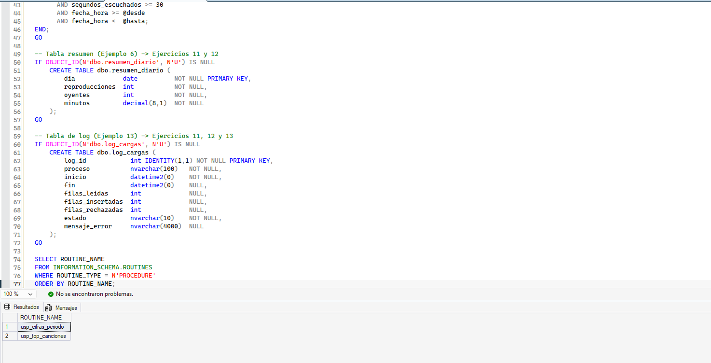

*Figura 1. Procedimientos de la teoría disponibles en SonoraDB.*

### 2.2 Ejercicio 1. Usuarios por plan

El procedimiento no tiene parámetros: agrupa los usuarios por plan y los ordena de más a menos, con el nombre del plan como desempate.

Script: `sql/sesion1_procedures/ej01_usuarios_por_plan.sql`

```sql
USE SonoraDB;
GO

CREATE OR ALTER PROCEDURE dbo.usp_usuarios_por_plan
AS
BEGIN
    SET NOCOUNT ON;

    SELECT plan_suscripcion, COUNT(*) AS usuarios
    FROM dbo.usuarios
    GROUP BY plan_suscripcion
    ORDER BY usuarios DESC, plan_suscripcion;
END;
GO

EXEC dbo.usp_usuarios_por_plan;
```

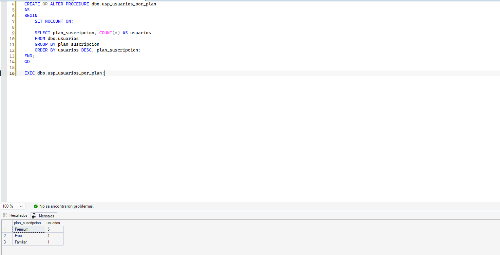

*Figura 2. Ejecución de dbo.usp_usuarios_por_plan: Premium 5, Free 4 y Familiar 1.*

### 2.3 Ejercicio 2. Catálogo de un artista

Script: `sql/sesion1_procedures/ej02_canciones_de_artista.sql`

```sql
USE SonoraDB;
GO

CREATE OR ALTER PROCEDURE dbo.usp_canciones_de_artista
    @artista  nvarchar(100)
AS
BEGIN
    SET NOCOUNT ON;

    SELECT c.titulo, c.duracion_seg, c.fecha_lanzamiento
    FROM dbo.canciones AS c
    JOIN dbo.artistas  AS a ON a.artista_id = c.artista_id
    WHERE a.nombre = @artista
    ORDER BY c.fecha_lanzamiento;
END;
GO

EXEC dbo.usp_canciones_de_artista @artista = N'MC Brisa';

EXEC dbo.usp_canciones_de_artista @artista = N'Los Planetas';
```

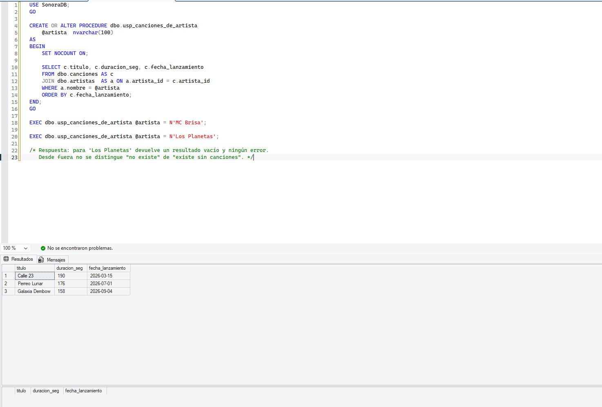

*Figura 3. Catálogo de MC Brisa (tres canciones) y resultado vacío para Los Planetas.*

Para MC Brisa devuelve sus tres canciones ordenadas por fecha de lanzamiento. Para Los Planetas devuelve un resultado vacío, con las cabeceras y sin filas, y ningún error. Desde fuera no se distingue si el artista no existe o si existe y no tiene canciones, porque las dos situaciones producen la misma salida. Para distinguirlas habría que comprobar antes la existencia del artista y lanzar un error o devolver un código de retorno distinto.

### 2.4 Ejercicio 3. Cinco llamadas a usp_top_canciones

El procedimiento tiene los parámetros @desde, @hasta, @top = 3 y @plan = NULL, en ese orden. La predicción para cada llamada fue la siguiente, y la ejecución la confirmó:

| Llamada | Resultado | Motivo |
| --- | --- | --- |
| a) | Msg 201 | Falta @hasta, que no tiene valor por defecto. |
| b) | 2 filas | Todos los parámetros van por nombre, así que el orden da igual. Filtra el plan Familiar. |
| c) | Msg 8114 | El tercer valor por posición va a @top, que es int, y N'Free' no se puede convertir. |
| d) | Msg 119 | Después de un parámetro por nombre no puede ir uno por posición. |
| e) | 0 filas | No hay error, pero ninguna fila cumple fecha >= 23/09 y fecha < 16/09. |

*Tabla 1. Resultado de las cinco llamadas.*

Script: `sql/sesion1_procedures/ej03_llamadas_top_canciones.sql`

```sql
USE SonoraDB;
GO

-- a) Falta @hasta  ->  Msg 201 (expects parameter '@hasta', which was not supplied)
EXEC dbo.usp_top_canciones '2026-09-16';

-- b) Por nombre y en otro orden: válido. Solo plan Familiar  ->  2 filas
EXEC dbo.usp_top_canciones @plan = N'Familiar', @hasta = '2026-09-23', @desde = '2026-09-16';

-- c) El tercer valor por posición va a @top (int), no a @plan
--    ->  Msg 8114 (Error converting data type nvarchar to int)
EXEC dbo.usp_top_canciones '2026-09-16', '2026-09-23', N'Free';

-- d) Tras un parámetro por nombre no puede ir uno por posición
--    ->  Msg 119 (Must pass parameter number 2 and subsequent parameters as '@name = value')
EXEC dbo.usp_top_canciones @desde = '2026-09-16', '2026-09-23';

-- e) Fechas al revés: no hay error, pero ninguna fila cumple
--    fecha >= 23/09 y fecha < 16/09  ->  0 filas
EXEC dbo.usp_top_canciones '2026-09-23', '2026-09-16';
```

Las llamadas se ejecutaron de una en una. Al lanzarlas juntas, el Msg 119 de la llamada d) aparece al compilar el lote y SQL Server lo rechaza entero sin ejecutar ninguna de las cinco, así que solo se ve ese error.

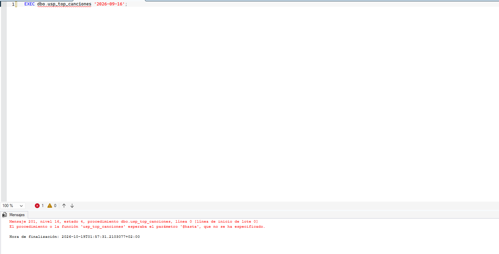

*Figura 4. Llamada a): Msg 201, falta el parámetro @hasta.*

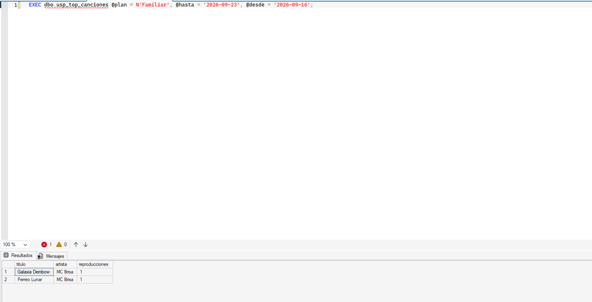

*Figura 5. Llamada b): dos filas para el plan Familiar.*

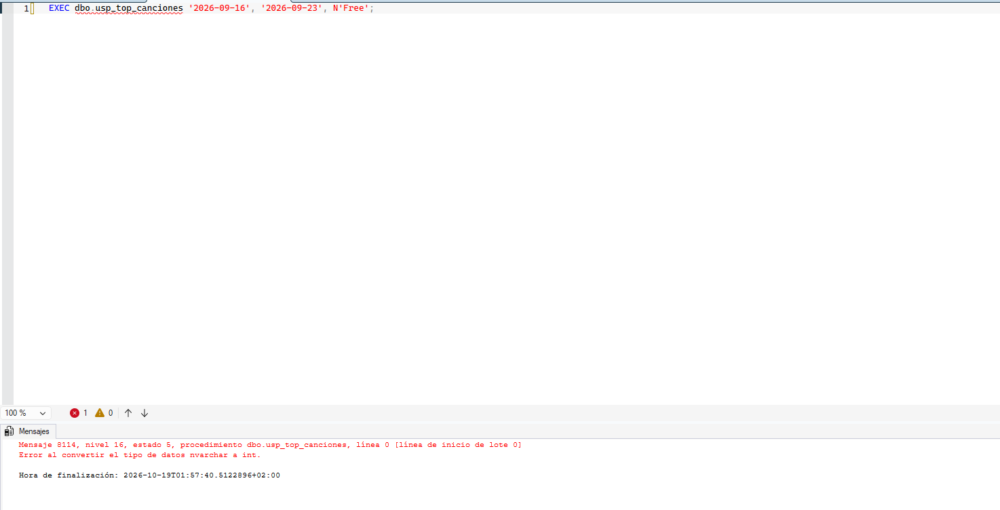

*Figura 6. Llamada c): Msg 8114, error al convertir nvarchar a int.*

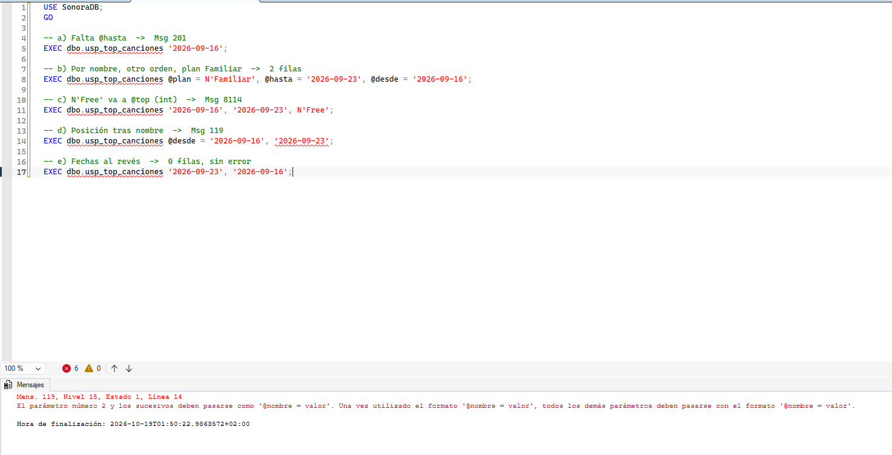

*Figura 7. Llamada d): Msg 119, parámetro por posición tras uno por nombre.*

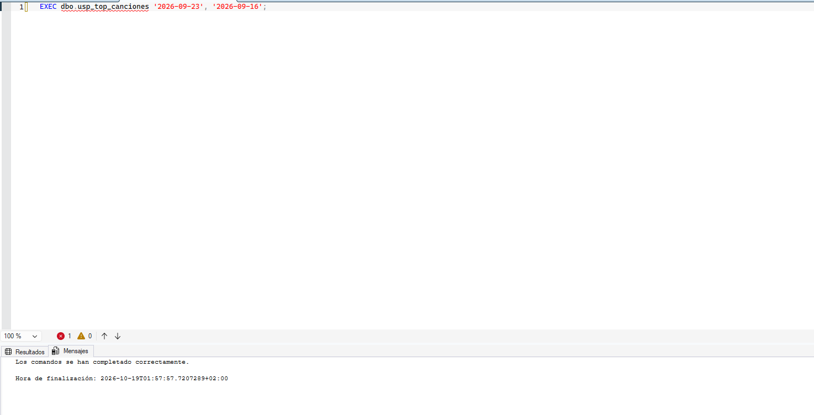

*Figura 8. Llamada e): se completa sin error y devuelve cero filas.*

### 2.5 Ejercicio 4. Altas desde una fecha

El filtro opcional se resuelve con la condición (@pais IS NULL OR pais = @pais): si no se indica país, la primera parte es cierta para todas las filas y no filtra.

Script: `sql/sesion1_procedures/ej04_altas_desde.sql`

```sql
USE SonoraDB;
GO

CREATE OR ALTER PROCEDURE dbo.usp_altas_desde
    @desde  date,
    @pais   char(2) = NULL
AS
BEGIN
    SET NOCOUNT ON;

    SELECT nombre_usuario, pais, plan_suscripcion, fecha_alta
    FROM dbo.usuarios
    WHERE fecha_alta >= @desde
      AND (@pais IS NULL OR pais = @pais)
    ORDER BY fecha_alta, nombre_usuario;
END;
GO

EXEC dbo.usp_altas_desde @desde = '2026-01-01';

EXEC dbo.usp_altas_desde @desde = '2026-01-01', @pais = 'ES';
```

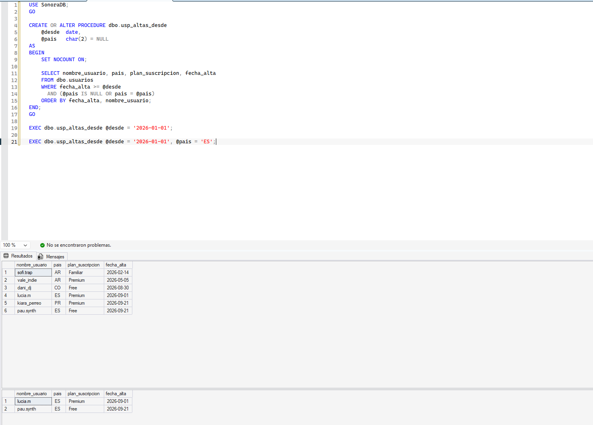

*Figura 9. Altas desde el 01/01/2026: seis usuarios sin filtro de país y dos para España.*

### 2.6 Ejercicio 5. Actividad de un usuario con parámetros OUTPUT

El procedimiento asigna los dos valores en un único SELECT y no devuelve ninguna tabla. COALESCE evita que los minutos queden a NULL cuando no hay reproducciones.

Script: `sql/sesion1_procedures/ej05_actividad_usuario.sql`

```sql
USE SonoraDB;
GO

CREATE OR ALTER PROCEDURE dbo.usp_actividad_usuario
    @nombre_usuario  nvarchar(50),
    @reproducciones  int           OUTPUT,
    @minutos         decimal(8,1)  OUTPUT
AS
BEGIN
    SET NOCOUNT ON;

    SELECT @reproducciones = COUNT(*),
           @minutos        = CAST(COALESCE(SUM(r.segundos_escuchados), 0) / 60.0 AS decimal(8,1))
    FROM dbo.reproducciones AS r
    JOIN dbo.usuarios       AS u ON u.usuario_id = r.usuario_id
    WHERE u.nombre_usuario = @nombre_usuario
      AND r.tipo_contenido = N'Canción'
      AND r.segundos_escuchados >= 30;
END;
GO

-- Ejecutar el bloque completo de una vez
DECLARE @n int, @min decimal(8,1);

EXEC dbo.usp_actividad_usuario @nombre_usuario = N'alexbeats',
     @reproducciones = @n OUTPUT, @minutos = @min OUTPUT;
SELECT N'alexbeats' AS usuario, @n AS reproducciones, @min AS minutos;

EXEC dbo.usp_actividad_usuario @nombre_usuario = N'vale_indie',
     @reproducciones = @n OUTPUT, @minutos = @min OUTPUT;
SELECT N'vale_indie' AS usuario, @n AS reproducciones, @min AS minutos;

EXEC dbo.usp_actividad_usuario @nombre_usuario = N'fantasma',
     @reproducciones = @n OUTPUT, @minutos = @min OUTPUT;
SELECT N'fantasma' AS usuario, @n AS reproducciones, @min AS minutos;
GO
```

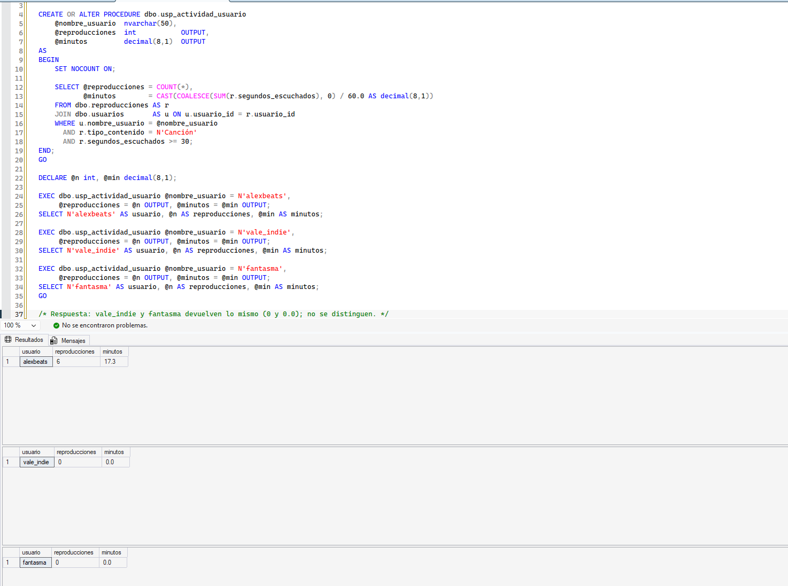

*Figura 10. alexbeats: 6 reproducciones y 17.3 minutos. vale_indie y fantasma: 0 y 0.0.*

vale_indie, que existe y no tiene reproducciones válidas, y fantasma, que no existe, devuelven exactamente lo mismo: 0 y 0.0. Con estos dos parámetros no se pueden distinguir. Se resolvería validando la existencia del usuario o añadiendo un tercer parámetro de salida, por ejemplo @existe bit.

### 2.7 Ejercicio 6. Segmento de un usuario

La validación de existencia va al principio y termina con RETURN 1. Los segmentos se encadenan con IF ... ELSE IF, de la condición más exigente a la menos exigente, para que cada usuario caiga en el primero que cumple.

Script: `sql/sesion1_procedures/ej06_segmento_usuario.sql`

```sql
USE SonoraDB;
GO

CREATE OR ALTER PROCEDURE dbo.usp_segmento_usuario
    @nombre_usuario  nvarchar(50),
    @desde           date,
    @hasta           date
AS
BEGIN
    SET NOCOUNT ON;

    DECLARE @minutos decimal(8,1), @segmento nvarchar(20);

    IF NOT EXISTS (SELECT 1 FROM dbo.usuarios WHERE nombre_usuario = @nombre_usuario)
    BEGIN
        PRINT N'Usuario no encontrado: ' + @nombre_usuario;
        RETURN 1;
    END;

    SELECT @minutos = CAST(COALESCE(SUM(r.segundos_escuchados), 0) / 60.0 AS decimal(8,1))
    FROM dbo.reproducciones AS r
    JOIN dbo.usuarios       AS u ON u.usuario_id = r.usuario_id
    WHERE u.nombre_usuario = @nombre_usuario
      AND r.tipo_contenido = N'Canción'
      AND r.segundos_escuchados >= 30
      AND r.fecha_hora >= @desde
      AND r.fecha_hora <  @hasta;

    IF @minutos >= 10
        SET @segmento = N'Intensivo';
    ELSE IF @minutos >= 6
        SET @segmento = N'Habitual';
    ELSE IF @minutos > 0
        SET @segmento = N'Ocasional';
    ELSE
        SET @segmento = N'Sin actividad';

    SELECT @nombre_usuario AS nombre_usuario, @minutos AS minutos, @segmento AS segmento;

    RETURN 0;
END;
GO

-- Ejecutar el bloque completo de una vez
DECLARE @estado int;

EXEC @estado = dbo.usp_segmento_usuario N'lucia.m',    '2026-09-16', '2026-09-23';
SELECT N'lucia.m' AS usuario, @estado AS estado;

EXEC @estado = dbo.usp_segmento_usuario N'marta_rock', '2026-09-16', '2026-09-23';
SELECT N'marta_rock' AS usuario, @estado AS estado;

EXEC @estado = dbo.usp_segmento_usuario N'sofi.trap',  '2026-09-16', '2026-09-23';
SELECT N'sofi.trap' AS usuario, @estado AS estado;

EXEC @estado = dbo.usp_segmento_usuario N'vale_indie', '2026-09-16', '2026-09-23';
SELECT N'vale_indie' AS usuario, @estado AS estado;

EXEC @estado = dbo.usp_segmento_usuario N'fantasma',   '2026-09-16', '2026-09-23';
SELECT N'fantasma' AS usuario, @estado AS estado;
```

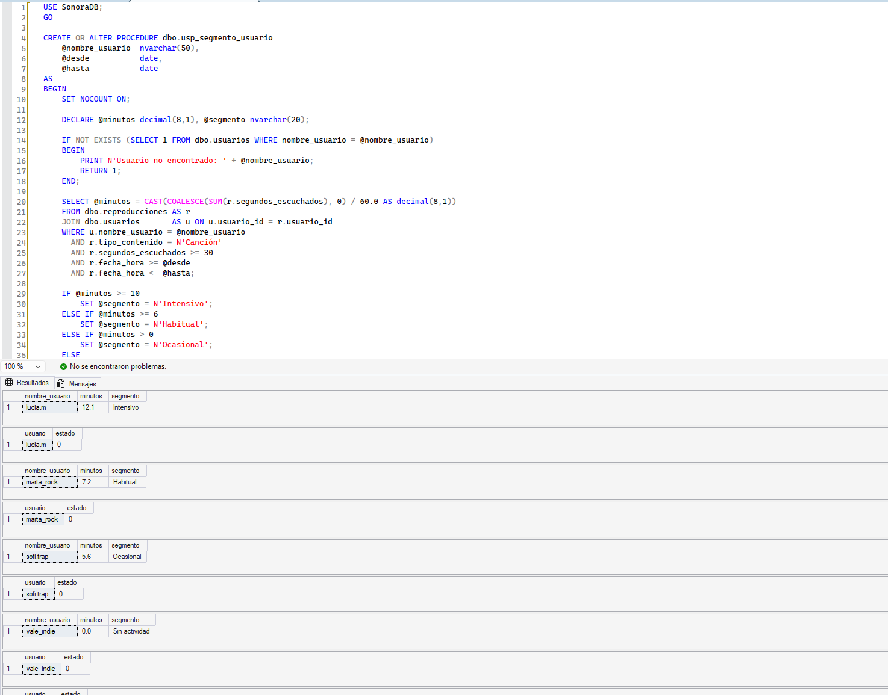

*Figura 11. Segmentos de la semana de análisis y códigos de retorno.*

lucia.m sale Intensivo con 12.1 minutos, marta_rock Habitual con 7.2, sofi.trap Ocasional con 5.6 y vale_indie Sin actividad con 0.0, todos con código de retorno 0. Para fantasma no hay fila de resultado, el código de retorno es 1 y en la pestaña Mensajes aparece Usuario no encontrado: fantasma.

### 2.8 Ejercicio 7. Cifras día a día con WHILE

El bucle avanza un día en cada vuelta, llama a usp_cifras_periodo para el intervalo [día, día siguiente) y guarda los dos parámetros de salida en una variable de tabla. Los días sin actividad aparecen con 0 porque el procedimiento llamado usa COALESCE.

Script: `sql/sesion1_procedures/ej07_cifras_por_dia.sql`

```sql
USE SonoraDB;
GO

CREATE OR ALTER PROCEDURE dbo.usp_cifras_por_dia
    @desde  date,
    @hasta  date
AS
BEGIN
    SET NOCOUNT ON;

    DECLARE @resultado TABLE (
        dia             date          NOT NULL PRIMARY KEY,
        reproducciones  int           NOT NULL,
        minutos         decimal(8,1)  NOT NULL
    );

    DECLARE @dia date = @desde;
    DECLARE @dia_siguiente date;
    DECLARE @n int, @min decimal(8,1);

    WHILE @dia < @hasta
    BEGIN
        SET @dia_siguiente = DATEADD(DAY, 1, @dia);

        EXEC dbo.usp_cifras_periodo
             @desde = @dia,
             @hasta = @dia_siguiente,
             @reproducciones = @n OUTPUT,
             @minutos = @min OUTPUT;

        INSERT INTO @resultado (dia, reproducciones, minutos)
        VALUES (@dia, @n, @min);

        SET @dia = @dia_siguiente;
    END;

    SELECT dia, reproducciones, minutos
    FROM @resultado
    ORDER BY dia;
END;
GO

EXEC dbo.usp_cifras_por_dia @desde = '2026-09-20', @hasta = '2026-09-25';
```

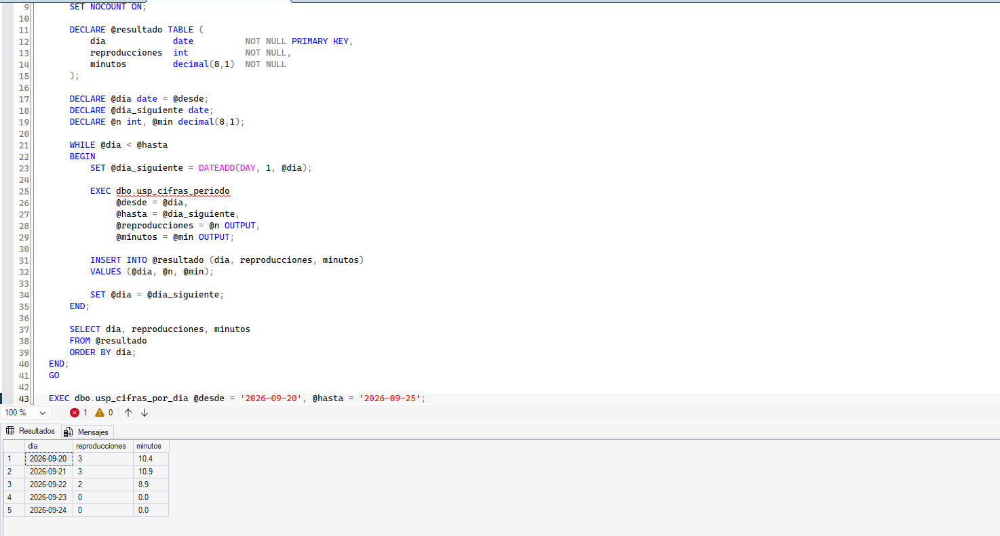

*Figura 12. Cifras del 20 al 24 de septiembre, incluidos los dos días sin actividad.*

### 2.9 Ejercicio 8. Predecir un TRY ... CATCH

Script: `sql/sesion1_procedures/ej08_try_catch_pasos.sql`

```sql
USE SonoraDB;
GO

DROP TABLE IF EXISTS #pasos;

CREATE TABLE #pasos (
    paso   int           NOT NULL PRIMARY KEY,
    texto  nvarchar(30)  NOT NULL
);

BEGIN TRY
    INSERT INTO #pasos (paso, texto) VALUES (1, N'inicio');
    INSERT INTO #pasos (paso, texto) VALUES (2, NULL);
    INSERT INTO #pasos (paso, texto) VALUES (3, N'después del fallo');
END TRY
BEGIN CATCH
    INSERT INTO #pasos (paso, texto) VALUES (4, N'en el CATCH');

    IF ERROR_NUMBER() = 2627
        INSERT INTO #pasos (paso, texto) VALUES (5, N'clave duplicada');
        INSERT INTO #pasos (paso, texto) VALUES (6, N'¿y esta?');
END CATCH;

INSERT INTO #pasos (paso, texto) VALUES (7, N'fin del script');

SELECT paso, texto FROM #pasos ORDER BY paso;
```

La predicción fue que el SELECT devuelve los pasos 1, 4, 6 y 7, y la ejecución lo confirmó. El paso 1 se inserta. El paso 2 falla por la restricción NOT NULL, con el error 515, y la ejecución salta al CATCH, así que el paso 3 no llega a ejecutarse. En el CATCH se inserta el paso 4. El IF compara con 2627, que es el error de clave duplicada, y como el error real es 515 el paso 5 no se inserta. El paso 6 se inserta siempre: sin BEGIN ... END, el IF solo controla la instrucción siguiente. Como el CATCH no relanza el error, el script continúa y se inserta el paso 7.

Si se añade THROW; antes de END CATCH, después de insertar los pasos 4 y 6 se relanza el error 515. No hay otro TRY que lo recoja, así que el lote termina ahí: ni el paso 7 ni el SELECT final se ejecutan y en Mensajes aparece el error en rojo.

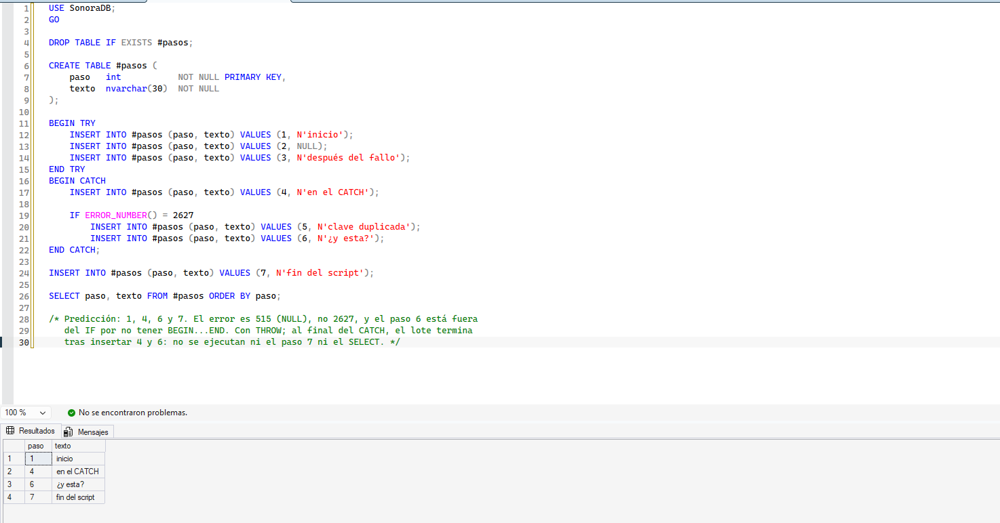

*Figura 13. El SELECT final devuelve los pasos 1, 4, 6 y 7.*

### 2.10 Ejercicio 9. Alta de artista con validaciones

Las dos validaciones se hacen antes de abrir la transacción. El cálculo del nuevo identificador se hace dentro de ella con UPDLOCK y HOLDLOCK, para que dos altas simultáneas no obtengan el mismo valor. El CATCH deshace la transacción si sigue abierta y relanza el error original.

Script: `sql/sesion1_procedures/ej09_alta_artista.sql`

```sql
USE SonoraDB;
GO

CREATE OR ALTER PROCEDURE dbo.usp_alta_artista
    @nombre      nvarchar(100),
    @pais        char(2),
    @genero      nvarchar(100),
    @artista_id  int OUTPUT
AS
BEGIN
    SET NOCOUNT ON;
    SET XACT_ABORT ON;

    DECLARE @genero_id int;

    BEGIN TRY
        SELECT @genero_id = genero_id
        FROM dbo.generos
        WHERE nombre = @genero;

        IF @genero_id IS NULL
            THROW 50010, N'El género indicado no existe.', 1;

        IF EXISTS (SELECT 1 FROM dbo.artistas WHERE nombre = @nombre)
            THROW 50011, N'Ya existe un artista con ese nombre.', 1;

        BEGIN TRAN;

            SELECT @artista_id = COALESCE(MAX(artista_id), 0) + 1
            FROM dbo.artistas WITH (UPDLOCK, HOLDLOCK);

            INSERT INTO dbo.artistas (artista_id, nombre, pais, genero_id)
            VALUES (@artista_id, @nombre, @pais, @genero_id);

        COMMIT;
    END TRY
    BEGIN CATCH
        IF @@TRANCOUNT > 0 ROLLBACK;

        THROW;
    END CATCH;
END;
GO

-- Llamada 1: género inexistente  ->  Msg 50010
DECLARE @id int;
EXEC dbo.usp_alta_artista @nombre = N'Aurora Boreal', @pais = 'ES', @genero = N'Synthwave',
     @artista_id = @id OUTPUT;
SELECT @id AS artista_id;
GO

-- Llamada 2: correcta  ->  devuelve 10
DECLARE @id int;
EXEC dbo.usp_alta_artista @nombre = N'Aurora Boreal', @pais = 'ES', @genero = N'House',
     @artista_id = @id OUTPUT;
SELECT @id AS artista_id;

SELECT artista_id, nombre, pais, genero_id
FROM dbo.artistas
WHERE artista_id = @id;
GO

-- Llamada 3: repetida  ->  Msg 50011
DECLARE @id int;
EXEC dbo.usp_alta_artista @nombre = N'Aurora Boreal', @pais = 'ES', @genero = N'House',
     @artista_id = @id OUTPUT;
GO

-- Limpieza: conservar el punto de partida
DELETE FROM dbo.artistas WHERE artista_id > 9;
```

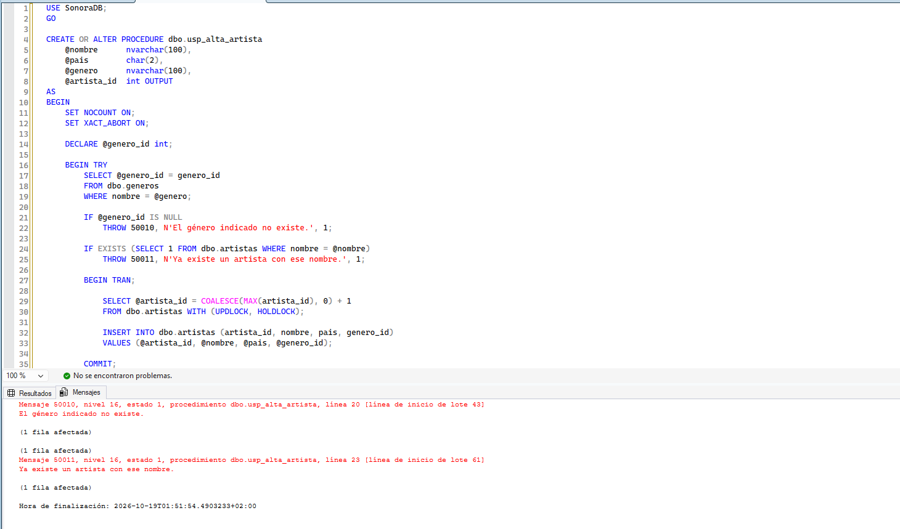

*Figura 14. Mensajes: Msg 50010 en la primera llamada y Msg 50011 en la tercera.*

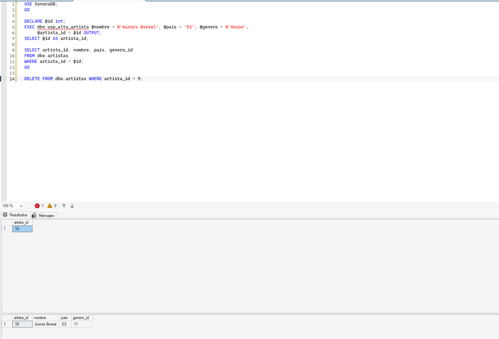

*Figura 15. Resultados de la segunda llamada: identificador 10 y fila de Aurora Boreal con el género 11.*

### 2.11 Ejercicio 10. Baja de usuario

El script contiene las dos versiones del procedimiento. Entre los apartados a) y c), y al final, se ejecuta el punto de partida para recuperar a pau.synth y sus dos reproducciones.

Script: `sql/sesion1_procedures/ej10_baja_usuario.sql`

```sql
USE SonoraDB;
GO

DROP TABLE IF EXISTS dbo.bajas_usuarios;

CREATE TABLE dbo.bajas_usuarios (
    usuario_id      int           NOT NULL PRIMARY KEY,
    nombre_usuario  nvarchar(50)  NOT NULL,
    motivo          nvarchar(30)  NOT NULL,
    fecha_baja      datetime2(0)  NOT NULL DEFAULT SYSDATETIME(),
    CONSTRAINT CK_bajas_usuarios_motivo
        CHECK (motivo IN (N'Solicitud del usuario', N'Impago', N'Fraude'))
);
GO

CREATE OR ALTER PROCEDURE dbo.usp_baja_usuario
    @nombre_usuario  nvarchar(50),
    @motivo          nvarchar(30)
AS
BEGIN
    SET NOCOUNT ON;

    DECLARE @usuario_id int;

    SET @usuario_id = (SELECT usuario_id FROM dbo.usuarios WHERE nombre_usuario = @nombre_usuario);

    BEGIN TRAN;

        DELETE FROM dbo.reproducciones
        WHERE usuario_id = @usuario_id;

        INSERT INTO dbo.bajas_usuarios (usuario_id, nombre_usuario, motivo)
        VALUES (@usuario_id, @nombre_usuario, @motivo);

        DELETE FROM dbo.usuarios
        WHERE usuario_id = @usuario_id;

    COMMIT;
END;
GO

EXEC dbo.usp_baja_usuario @nombre_usuario = N'pau.synth', @motivo = N'Se ha cansado';
GO

SELECT (SELECT COUNT(*) FROM dbo.reproducciones) AS reproducciones,
       (SELECT COUNT(*) FROM dbo.usuarios)       AS usuarios,
       (SELECT COUNT(*) FROM dbo.bajas_usuarios) AS bajas;
GO
CREATE OR ALTER PROCEDURE dbo.usp_baja_usuario
    @nombre_usuario  nvarchar(50),
    @motivo          nvarchar(30)
AS
BEGIN
    SET NOCOUNT ON;
    SET XACT_ABORT ON;

    DECLARE @usuario_id int;

    BEGIN TRY
        SELECT @usuario_id = usuario_id
        FROM dbo.usuarios
        WHERE nombre_usuario = @nombre_usuario;

        IF @usuario_id IS NULL
            THROW 50020, N'El usuario no existe.', 1;

        BEGIN TRAN;

            DELETE FROM dbo.reproducciones
            WHERE usuario_id = @usuario_id;

            INSERT INTO dbo.bajas_usuarios (usuario_id, nombre_usuario, motivo)
            VALUES (@usuario_id, @nombre_usuario, @motivo);

            DELETE FROM dbo.usuarios
            WHERE usuario_id = @usuario_id;

        COMMIT;
    END TRY
    BEGIN CATCH
        IF @@TRANCOUNT > 0 ROLLBACK;

        THROW;
    END CATCH;
END;
GO

EXEC dbo.usp_baja_usuario @nombre_usuario = N'pau.synth', @motivo = N'Se ha cansado';
GO

SELECT (SELECT COUNT(*) FROM dbo.reproducciones) AS reproducciones,
       (SELECT COUNT(*) FROM dbo.usuarios)       AS usuarios,
       (SELECT COUNT(*) FROM dbo.bajas_usuarios) AS bajas;
GO
EXEC dbo.usp_baja_usuario @nombre_usuario = N'pau.synth', @motivo = N'Solicitud del usuario';
GO

SELECT (SELECT COUNT(*) FROM dbo.reproducciones) AS reproducciones,
       (SELECT COUNT(*) FROM dbo.usuarios)       AS usuarios,
       (SELECT COUNT(*) FROM dbo.bajas_usuarios) AS bajas;
GO
```

| Apartado | reproducciones | usuarios | bajas |
| --- | --- | --- | --- |
| a) Versión de Hugo, motivo no admitido | 41 | 9 | 0 |
| c) Versión con plantilla, motivo no admitido | 43 | 10 | 0 |
| d) Versión con plantilla, motivo admitido | 41 | 9 | 1 |

*Tabla 2. Recuentos tras cada llamada.*

En el apartado a), el INSERT en bajas_usuarios falla por la restricción CHECK del motivo (Msg 547), pero ese error solo anula su propia instrucción. Sin SET XACT_ABORT ON ni TRY ... CATCH la ejecución sigue: el DELETE de usuarios se ejecuta, porque las reproducciones del usuario ya se habían borrado, y el COMMIT confirma los dos DELETE. El usuario y sus dos reproducciones desaparecen sin que quede constancia de la baja. La transacción existe, pero no protege nada.

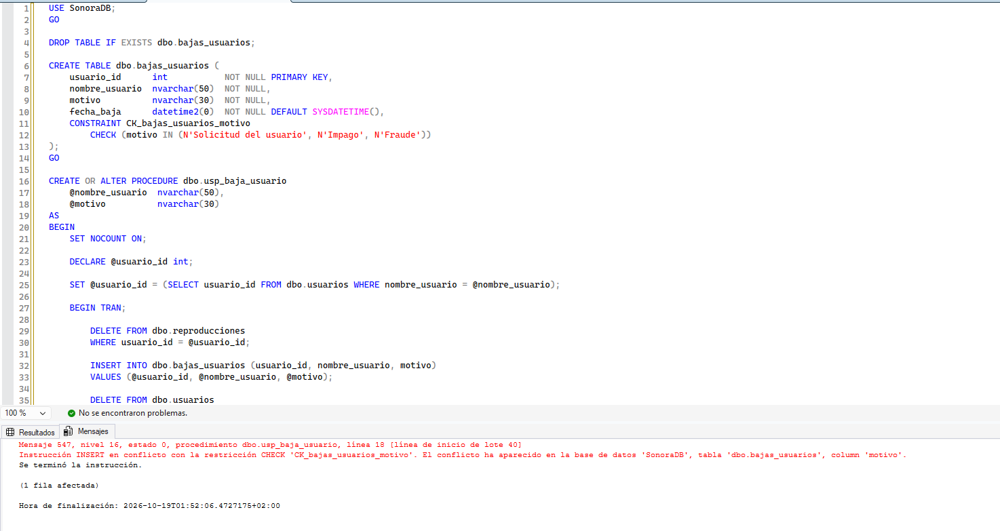

*Figura 16. Apartado a): Msg 547 por la restricción CK_bajas_usuarios_motivo.*

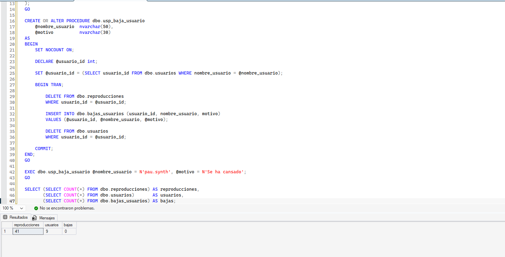

*Figura 17. Apartado a): 41 reproducciones, 9 usuarios y ninguna baja.*

Con la plantilla, el mismo error salta al CATCH, el ROLLBACK deshace el borrado de las reproducciones y THROW devuelve el error original, así que los recuentos no cambian. Con un motivo admitido las tres operaciones se completan juntas.

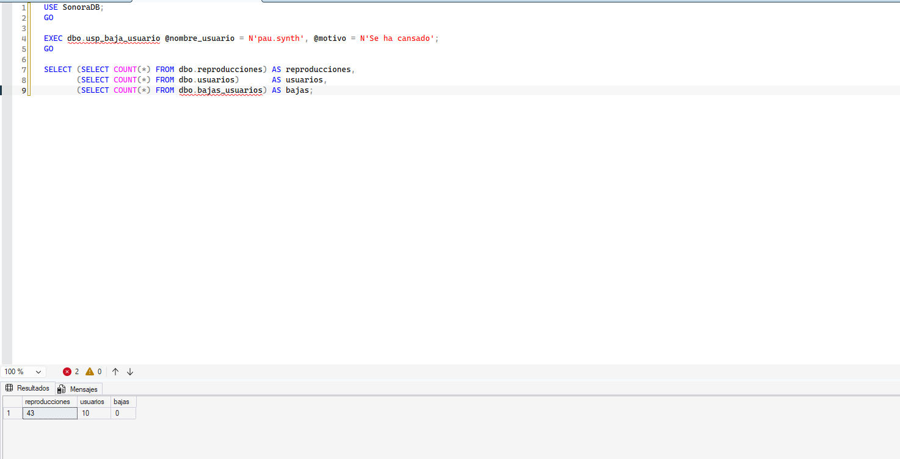

*Figura 18. Apartado c): con la plantilla, el fallo no deja cambios (43, 10 y 0).*


*Figura 19. Apartado d): baja completa con motivo admitido (41, 9 y 1).*

### 2.12 Ejercicio 11. Refresco del resumen con log y transacción

El inicio se anota antes del TRY y fuera de cualquier transacción, para que la fila del log no se pierda con un ROLLBACK. La validación del periodo está dentro del TRY, de modo que también queda registrada como error. El DELETE y el INSERT van en una sola transacción, y en el CATCH el log se actualiza después del ROLLBACK.

Script: `sql/sesion1_procedures/ej11_refrescar_resumen_con_log.sql`

```sql
USE SonoraDB;
GO

CREATE OR ALTER PROCEDURE dbo.usp_refrescar_resumen_diario
    @desde  date,
    @hasta  date
AS
BEGIN
    SET NOCOUNT ON;
    SET XACT_ABORT ON;

    DECLARE @log_id int, @insertadas int;
    DECLARE @periodo nvarchar(40) = CAST(@desde AS nvarchar(10)) + N' y ' + CAST(@hasta AS nvarchar(10));

    -- 1. Anotar el inicio, antes del TRY y fuera de cualquier transacción
    INSERT INTO dbo.log_cargas (proceso, inicio, estado)
    VALUES (N'usp_refrescar_resumen_diario', SYSDATETIME(), N'En curso');

    SET @log_id = SCOPE_IDENTITY();

    BEGIN TRY
        -- 2. Validación dentro del TRY para que el fallo también quede en el log
        IF @desde IS NULL OR @hasta IS NULL OR @desde >= @hasta
            THROW 50001, N'Periodo no válido: @desde debe ser anterior a @hasta.', 1;

        -- 3. DELETE e INSERT como una sola operación
        BEGIN TRAN;

            DELETE FROM dbo.resumen_diario
            WHERE dia >= @desde
              AND dia <  @hasta;

            INSERT INTO dbo.resumen_diario (dia, reproducciones, oyentes, minutos)
            SELECT CAST(r.fecha_hora AS date),
                   COUNT(*),
                   COUNT(DISTINCT r.usuario_id),
                   CAST(SUM(r.segundos_escuchados) / 60.0 AS decimal(8,1))
            FROM dbo.reproducciones AS r
            WHERE r.tipo_contenido = N'Canción'
              AND r.segundos_escuchados >= 30
              AND r.fecha_hora >= @desde
              AND r.fecha_hora <  @hasta
            GROUP BY CAST(r.fecha_hora AS date);

            SET @insertadas = @@ROWCOUNT;

        COMMIT;

        -- 4. Anotar el final correcto
        UPDATE dbo.log_cargas
        SET fin = SYSDATETIME(),
            filas_insertadas = @insertadas,
            estado = N'OK'
        WHERE log_id = @log_id;

        IF @insertadas = 0
            PRINT N'Aviso: sin reproducciones válidas entre ' + @periodo + N'.';
        ELSE
            PRINT N'Resumen actualizado entre ' + @periodo + N'. Días con datos: '
                  + CAST(@insertadas AS nvarchar(10)) + N'.';
    END TRY
    BEGIN CATCH
        IF @@TRANCOUNT > 0 ROLLBACK;

        -- 4. Anotar el error, siempre después del ROLLBACK
        UPDATE dbo.log_cargas
        SET fin = SYSDATETIME(),
            estado = N'Error',
            mensaje_error = ERROR_MESSAGE()
        WHERE log_id = @log_id;

        THROW;
    END CATCH;
END;
GO

-- Prueba 1: semana de análisis
EXEC dbo.usp_refrescar_resumen_diario @desde = '2026-09-16', @hasta = '2026-09-23';
GO

-- Prueba 2: fechas al revés  ->  Msg 50001
EXEC dbo.usp_refrescar_resumen_diario @desde = '2026-09-23', @hasta = '2026-09-16';
GO

SELECT TOP (2) proceso, filas_insertadas, estado, mensaje_error
FROM dbo.log_cargas
ORDER BY log_id DESC;
```

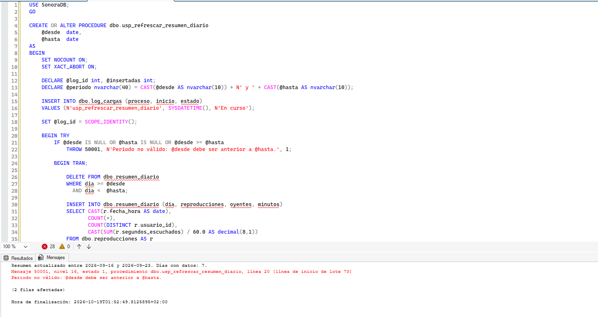

*Figura 20. Mensajes: refresco correcto con 7 días y Msg 50001 en la llamada con las fechas al revés.*

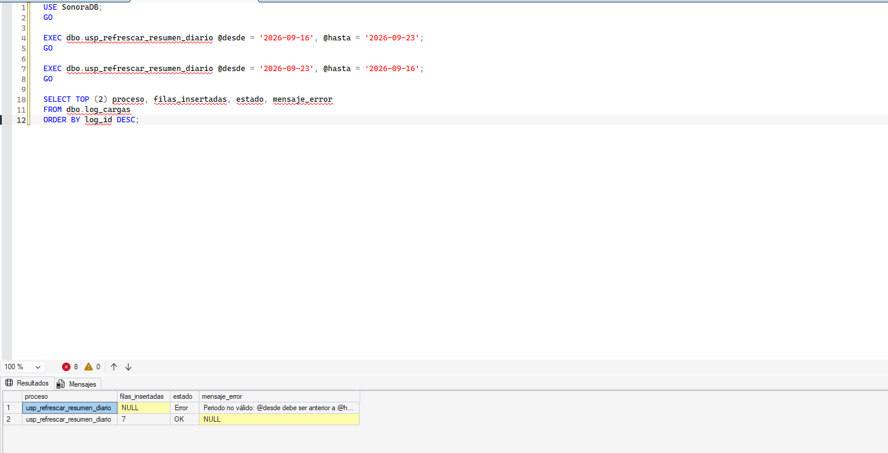

*Figura 21. Últimas dos filas del log: Error con su mensaje y OK con 7 filas insertadas.*

Sin la transacción, si el INSERT fallara justo después del DELETE, el borrado quedaría confirmado. Los cuadros de mando verían los días del periodo vacíos hasta que alguien volviera a lanzar el refresco, y nada en la tabla indicaría que faltan datos.

### 2.13 Ejercicio 12. Idempotencia

| Fragmento | Idempotente | Segunda ejecución y arreglo |
| --- | --- | --- |
| A | No | Falla con Msg 2627 por la clave primaria de dia. Sin esa clave duplicaría filas. Se arregla borrando antes el tramo o con WHERE NOT EXISTS. |
| B | No | Suma otros 5 segundos cada vez. Se arregla asignando el valor final en lugar de un incremento, o registrando que la corrección ya se aplicó. |
| C | Sí | Asigna un valor fijo: la segunda vez deja 'PR' igual que la primera. |
| D | Sí | La segunda ejecución no encuentra filas que borrar. |
| E | No | Añade una fila al log en cada ejecución, que es lo que se busca: el log cuenta ejecuciones. No debe arreglarse. |

*Tabla 3. Análisis de los cinco fragmentos.*

Para comprobar el arreglo del fragmento A ejecuté dos veces el borrado del tramo seguido del INSERT. Las dos veces afecta a 7 filas y la segunda no da error.

Script: `sql/sesion1_procedures/ej12_idempotencia.sql`

```sql
DELETE FROM dbo.resumen_diario
WHERE dia >= '2026-09-16' AND dia < '2026-09-23';

INSERT INTO dbo.resumen_diario (dia, reproducciones, oyentes, minutos)
SELECT CAST(fecha_hora AS date), COUNT(*), COUNT(DISTINCT usuario_id),
       CAST(SUM(segundos_escuchados) / 60.0 AS decimal(8,1))
FROM dbo.reproducciones
WHERE tipo_contenido = N'Canción' AND segundos_escuchados >= 30
  AND fecha_hora >= '2026-09-16' AND fecha_hora < '2026-09-23'
GROUP BY CAST(fecha_hora AS date);
```

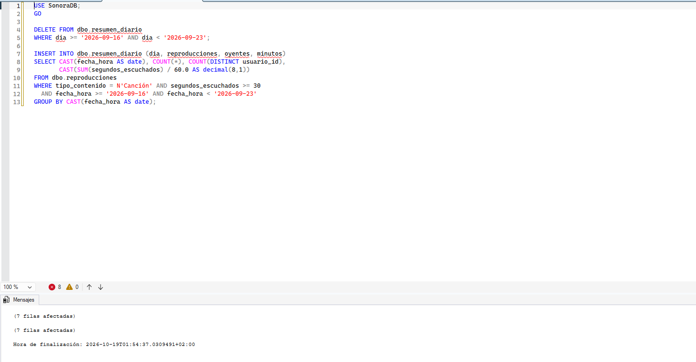

*Figura 22. Arreglo del fragmento A: borra 7 filas y vuelve a insertar 7.*

### 2.14 Ejercicio 13. Carga completa de altas de usuarios

El procedimiento sigue las cuatro etapas del Ejemplo 16. Primero anota el inicio en el log. Después lleva el lote a una tabla temporal: el DISTINCT elimina los duplicados exactos, el NOT EXISTS descarta los usuarios que ya existen y el CASE interior corrige Family a Familiar. El CASE exterior asigna el motivo de rechazo respetando el orden de controles. En una transacción guarda los rechazos y carga las altas correctas, y por último anota en el log las filas leídas, insertadas y rechazadas.

Script: `sql/sesion1_procedures/ej13_cargar_usuarios.sql`

```sql
USE SonoraDB;
GO

DROP TABLE IF EXISTS dbo.rechazos_altas;

CREATE TABLE dbo.rechazos_altas (
    log_id          int           NOT NULL,
    usuario_id      int           NULL,
    nombre_usuario  nvarchar(50)  NULL,
    motivo          nvarchar(60)  NOT NULL
);
GO

CREATE OR ALTER PROCEDURE dbo.usp_cargar_usuarios
AS
BEGIN
    SET NOCOUNT ON;
    SET XACT_ABORT ON;

    DECLARE @log_id int, @leidas int, @insertadas int, @rechazadas int;

    -- 1. Anotar el inicio
    INSERT INTO dbo.log_cargas (proceso, inicio, estado)
    VALUES (N'usp_cargar_usuarios', SYSDATETIME(), N'En curso');

    SET @log_id = SCOPE_IDENTITY();

    BEGIN TRY
        SET @leidas = (SELECT COUNT(*) FROM dbo.stg_usuarios_2309);

        -- 2. Staging: sin duplicados, sin usuarios ya existentes, plan corregido y validado
        SELECT x.usuario_id, x.nombre_usuario, x.email, x.pais, x.plan_suscripcion, x.fecha_alta,
               CASE
                   WHEN x.email IS NULL
                       THEN N'Email vacío'
                   WHEN x.plan_suscripcion NOT IN (N'Free', N'Premium', N'Familiar')
                       THEN N'Plan no reconocido'
               END AS motivo
        INTO #lote_usuarios
        FROM (
            SELECT DISTINCT
                   s.usuario_id, s.nombre_usuario, s.email, s.pais,
                   CASE WHEN s.plan_suscripcion = N'Family' THEN N'Familiar'
                        ELSE s.plan_suscripcion
                   END AS plan_suscripcion,
                   s.fecha_alta
            FROM dbo.stg_usuarios_2309 AS s
            WHERE NOT EXISTS (SELECT 1 FROM dbo.usuarios AS u
                              WHERE u.usuario_id = s.usuario_id)
        ) AS x;

        -- 3. Carga: rechazos y altas correctas, todo o nada
        BEGIN TRAN;

            INSERT INTO dbo.rechazos_altas (log_id, usuario_id, nombre_usuario, motivo)
            SELECT @log_id, l.usuario_id, l.nombre_usuario, l.motivo
            FROM #lote_usuarios AS l
            WHERE l.motivo IS NOT NULL;

            SET @rechazadas = @@ROWCOUNT;

            INSERT INTO dbo.usuarios (usuario_id, nombre_usuario, email, pais, plan_suscripcion, fecha_alta)
            SELECT l.usuario_id, l.nombre_usuario, l.email, l.pais, l.plan_suscripcion, l.fecha_alta
            FROM #lote_usuarios AS l
            WHERE l.motivo IS NULL;

            SET @insertadas = @@ROWCOUNT;

        COMMIT;

        -- 4. Anotar el final correcto
        UPDATE dbo.log_cargas
        SET fin = SYSDATETIME(),
            filas_leidas = @leidas,
            filas_insertadas = @insertadas,
            filas_rechazadas = @rechazadas,
            estado = N'OK'
        WHERE log_id = @log_id;
    END TRY
    BEGIN CATCH
        IF @@TRANCOUNT > 0 ROLLBACK;

        UPDATE dbo.log_cargas
        SET fin = SYSDATETIME(),
            filas_leidas = @leidas,
            estado = N'Error',
            mensaje_error = ERROR_MESSAGE()
        WHERE log_id = @log_id;

        THROW;
    END CATCH;
END;
GO

-- Dos ejecuciones seguidas (prueba de idempotencia)
EXEC dbo.usp_cargar_usuarios;
EXEC dbo.usp_cargar_usuarios;
GO

SELECT proceso, filas_leidas, filas_insertadas, filas_rechazadas, estado
FROM (SELECT TOP (2) * FROM dbo.log_cargas ORDER BY log_id DESC) AS t
ORDER BY log_id;

SELECT log_id, usuario_id, nombre_usuario, motivo
FROM dbo.rechazos_altas
ORDER BY log_id, usuario_id;

SELECT COUNT(*) AS usuarios FROM dbo.usuarios;
GO

-- Limpieza
DELETE FROM dbo.usuarios WHERE usuario_id > 10;
```

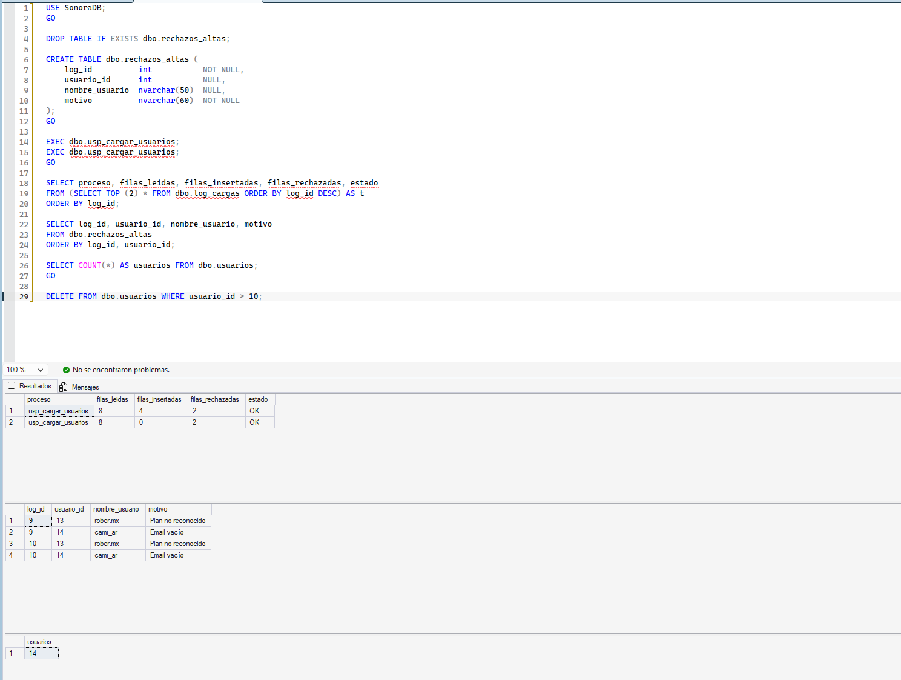

*Figura 23. Dos ejecuciones: 4 altas y 2 rechazos en la primera, 0 altas en la segunda, y 14 usuarios.*

La segunda ejecución no inserta nada porque los cuatro usuarios ya existen. Los dos rechazos se vuelven a registrar con el nuevo log_id, ya que rober.mx y cami_ar siguen sin poder entrar. La tabla de usuarios queda con 14 filas, y al final del script se borran los usuarios cargados para conservar el punto de partida.

## 3. Sesión 2. Triggers

Antes de los ejercicios ejecuté el script del punto de partida de la Sesión 2, que retira los triggers de la teoría y deja SonoraDB con las cifras de siempre. Todos los triggers se crean con CREATE OR ALTER y SET NOCOUNT ON, y ninguno guarda valores de inserted o deleted en variables, para que funcionen con cualquier número de filas.

### 3.1 Ejercicio 1. Registrar altas de artistas

Script: `sql/sesion2_triggers/ej01_artistas_alta.sql`

```sql
USE SonoraDB;
GO

DROP TABLE IF EXISTS dbo.altas_artistas;

CREATE TABLE dbo.altas_artistas (
    artista_id  int            NOT NULL,
    nombre      nvarchar(100)  NOT NULL,
    fecha_alta  datetime2(0)   NOT NULL DEFAULT SYSDATETIME()
);
GO

CREATE OR ALTER TRIGGER dbo.trg_artistas_alta
ON dbo.artistas
AFTER INSERT
AS
BEGIN
    SET NOCOUNT ON;

    INSERT INTO dbo.altas_artistas (artista_id, nombre)
    SELECT i.artista_id, i.nombre
    FROM inserted AS i;
END;
GO

-- Dos altas en una sola instrucción
INSERT INTO dbo.artistas (artista_id, nombre, pais, genero_id) VALUES
(10, N'Aurora Boreal',  'ES', 11),
(11, N'Trío Magnético', 'MX', 9);

SELECT artista_id, nombre, fecha_alta
FROM dbo.altas_artistas
ORDER BY artista_id;
GO

-- Borrar los dos artistas y volver a mirar
DELETE FROM dbo.artistas WHERE artista_id IN (10, 11);

SELECT artista_id, nombre, fecha_alta
FROM dbo.altas_artistas
ORDER BY artista_id;
GO

DROP TRIGGER IF EXISTS dbo.trg_artistas_alta;
```

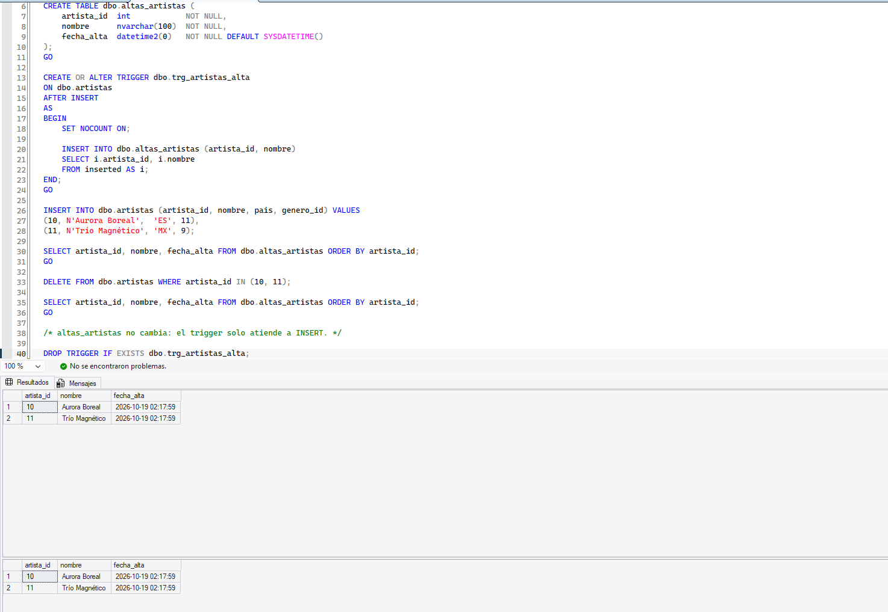

*Figura 24. altas_artistas antes y después de borrar a los dos artistas.*

El INSERT de dos filas dispara el trigger una sola vez, con las dos filas en inserted, y las dos quedan anotadas. Al borrar a los artistas, altas_artistas no cambia: el trigger solo atiende a INSERT, así que el DELETE no lo dispara, y nada borra el registro. Es lo esperable en un registro histórico, que anota que el alta ocurrió.

### 3.2 Ejercicio 2. Cuándo se dispara

| Instrucción | ¿Aviso? | Motivo |
| --- | --- | --- |
| a) | Sí | UPDATE de las tres canciones del artista 2. Un único aviso para las tres filas. |
| b) | Sí | El UPDATE no encuentra filas, pero el trigger se dispara igual. |
| c) | No | El trigger no vigila INSERT. |
| d) | No | Falla por la clave foránea de reproducciones (Msg 547). Un AFTER no se dispara tras una instrucción que no supera las restricciones. |
| e) | Sí | Borra la canción de prueba 116. |
| f) | No | Es otra tabla. |

*Tabla 4. Predicción del aviso para las seis instrucciones.*

Script: `sql/sesion2_triggers/ej02_canciones_aviso.sql`

```sql
USE SonoraDB;
GO

CREATE OR ALTER TRIGGER dbo.trg_canciones_aviso
ON dbo.canciones
AFTER UPDATE, DELETE
AS
BEGIN
    PRINT N'>> trg_canciones_aviso';
END;
GO

-- a) SÍ. UPDATE de 3 filas: un único aviso
UPDATE dbo.canciones SET duracion_seg = duracion_seg WHERE artista_id = 2;

-- b) SÍ. UPDATE que no encuentra filas: se dispara igual (0 rows affected)
UPDATE dbo.canciones SET titulo = N'Sin título' WHERE cancion_id = 500;

-- c) NO. El trigger no vigila INSERT
INSERT INTO dbo.canciones (cancion_id, titulo, artista_id, genero_id, duracion_seg, fecha_lanzamiento)
VALUES (116, N'Prueba', 1, 2, 100, '2026-09-25');

-- d) NO. Falla por la FOREIGN KEY de reproducciones (Msg 547): un trigger AFTER
--    no se dispara tras una instrucción que no supera las restricciones
DELETE FROM dbo.canciones WHERE cancion_id = 103;

-- e) SÍ. Borra la canción de prueba
DELETE FROM dbo.canciones WHERE cancion_id = 116;

-- f) NO. Es otra tabla
UPDATE dbo.artistas SET pais = pais WHERE artista_id = 2;
GO

DROP TRIGGER IF EXISTS dbo.trg_canciones_aviso;
```

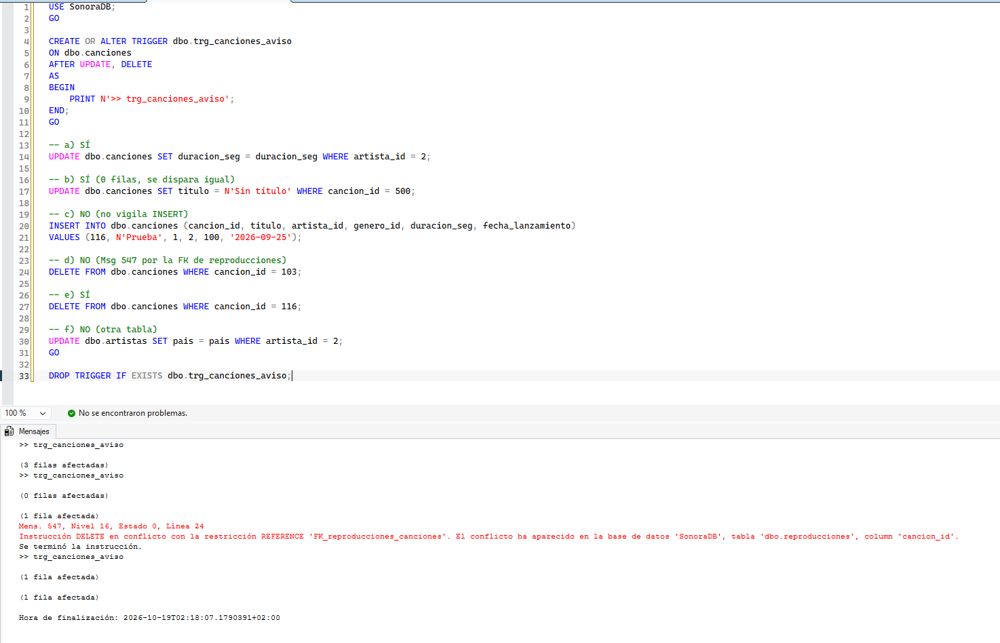

*Figura 25. El aviso aparece tres veces y la instrucción d) da el error 547.*

En este caso el script completo se pudo ejecutar de una vez: el Msg 547 anula solo su instrucción y el lote continúa, así que en Mensajes se ve el aviso detrás de a), b) y e) y en ningún otro punto.

### 3.3 Ejercicio 3. Filas de inserted y deleted

| Instrucción | inserted | deleted | Motivo |
| --- | --- | --- | --- |
| a) | 4 | 4 | UPDATE de los cuatro usuarios de España: cada fila aparece en las dos tablas. |
| b) | 0 | 0 | No hay usuarios por encima de 10. El trigger se dispara con las tablas vacías. |
| c) | 2 | 0 | Un INSERT solo llena inserted. |
| d) | 1 | 1 | Solo hay un usuario Free de México. |
| e) | 10 | 10 | UPDATE sin WHERE sobre los diez usuarios. |

*Tabla 5. Filas en inserted y deleted.*

Script: `sql/sesion2_triggers/ej03_conteo_inserted_deleted.sql`

```sql
USE SonoraDB;
GO

DROP TABLE IF EXISTS dbo.conteo_trigger;

CREATE TABLE dbo.conteo_trigger (
    filas_inserted  int NOT NULL,
    filas_deleted   int NOT NULL
);
GO

CREATE OR ALTER TRIGGER dbo.trg_usuarios_conteo
ON dbo.usuarios
AFTER INSERT, UPDATE, DELETE
AS
BEGIN
    SET NOCOUNT ON;

    INSERT INTO dbo.conteo_trigger (filas_inserted, filas_deleted)
    SELECT (SELECT COUNT(*) FROM inserted),
           (SELECT COUNT(*) FROM deleted);
END;
GO

-- a)
BEGIN TRAN;
    UPDATE dbo.usuarios SET pais = 'ES' WHERE pais = 'ES';
    SELECT 'a' AS instruccion, filas_inserted, filas_deleted FROM dbo.conteo_trigger;
ROLLBACK;
GO

-- b)
BEGIN TRAN;
    DELETE FROM dbo.usuarios WHERE usuario_id > 10;
    SELECT 'b' AS instruccion, filas_inserted, filas_deleted FROM dbo.conteo_trigger;
ROLLBACK;
GO

-- c)
BEGIN TRAN;
    INSERT INTO dbo.usuarios (usuario_id, nombre_usuario, email, pais, plan_suscripcion, fecha_alta) VALUES
    (11, N'teo.bass',  N'teo.bass@mail.com',  'ES', N'Free',    '2026-09-24'),
    (12, N'ines_wave', N'ines.wave@mail.com', 'CO', N'Premium', '2026-09-24');
    SELECT 'c' AS instruccion, filas_inserted, filas_deleted FROM dbo.conteo_trigger;
ROLLBACK;
GO

-- d)
BEGIN TRAN;
    UPDATE dbo.usuarios SET plan_suscripcion = N'Premium' WHERE plan_suscripcion = N'Free' AND pais = 'MX';
    SELECT 'd' AS instruccion, filas_inserted, filas_deleted FROM dbo.conteo_trigger;
ROLLBACK;
GO

-- e)
BEGIN TRAN;
    UPDATE dbo.usuarios SET email = email;
    SELECT 'e' AS instruccion, filas_inserted, filas_deleted FROM dbo.conteo_trigger;
ROLLBACK;
GO

DROP TRIGGER IF EXISTS dbo.trg_usuarios_conteo;
DROP TABLE IF EXISTS dbo.conteo_trigger;
```

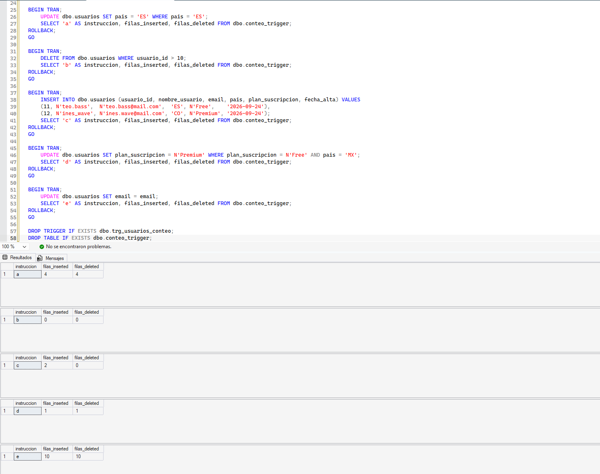

*Figura 26. Recuentos guardados por el trigger dentro de cada transacción.*

### 3.4 Ejercicio 4. Historial de cambios de puesto

IF NOT UPDATE(puesto) descarta las instrucciones que no mencionan la columna, como la reorganización de Carmen Lozano. UPDATE() solo indica que la columna aparece en el SET, así que el filtro i.puesto <> d.puesto descarta además las filas cuyo valor no cambia de verdad, como en el tercer UPDATE.

Script: `sql/sesion2_triggers/ej04_historial_puestos.sql`

```sql
USE SonoraDB;
GO

DROP TABLE IF EXISTS dbo.historial_puestos;

CREATE TABLE dbo.historial_puestos (
    cambio_id        int IDENTITY(1,1) NOT NULL PRIMARY KEY,
    empleado_id      int            NOT NULL,
    puesto_anterior  nvarchar(50)   NOT NULL,
    puesto_nuevo     nvarchar(50)   NOT NULL,
    fecha_cambio     datetime2(0)   NOT NULL DEFAULT SYSDATETIME()
);
GO

CREATE OR ALTER TRIGGER dbo.trg_empleados_historial_puestos
ON dbo.empleados
AFTER UPDATE
AS
BEGIN
    SET NOCOUNT ON;

    IF NOT UPDATE(puesto)
        RETURN;

    INSERT INTO dbo.historial_puestos (empleado_id, puesto_anterior, puesto_nuevo)
    SELECT i.empleado_id, d.puesto, i.puesto
    FROM inserted AS i
    JOIN deleted  AS d ON d.empleado_id = i.empleado_id
    WHERE i.puesto <> d.puesto;
END;
GO

-- Promoción de los dos Data Engineer
UPDATE dbo.empleados SET puesto = N'Senior Data Engineer' WHERE puesto = N'Data Engineer';

-- Reorganización: no menciona el puesto
UPDATE dbo.empleados SET jefe_id = 2 WHERE nombre = N'Carmen Lozano';

-- Menciona el puesto pero no lo cambia
UPDATE dbo.empleados SET puesto = puesto;

SELECT empleado_id, puesto_anterior, puesto_nuevo, fecha_cambio
FROM dbo.historial_puestos
ORDER BY empleado_id;
GO

-- Limpieza (enunciado)
DROP TRIGGER IF EXISTS dbo.trg_empleados_historial_puestos;

UPDATE dbo.empleados SET puesto = N'Data Engineer' WHERE empleado_id IN (5, 6);
UPDATE dbo.empleados SET jefe_id = 4 WHERE empleado_id = 7;
```

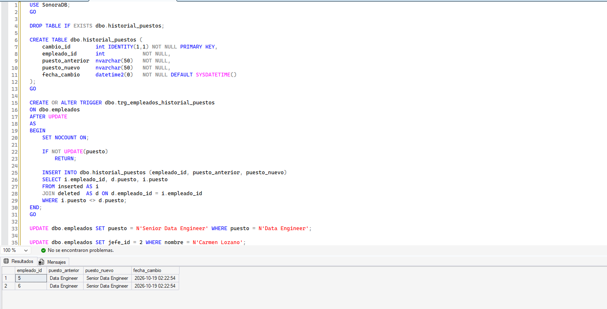

*Figura 27. Historial con las dos promociones de Data Engineer a Senior Data Engineer.*

### 3.5 Ejercicio 5. El contador de Pablo

| Apartado | Canción 103 | Canción 108 | Filas en reproducciones |
| --- | --- | --- | --- |
| a) | 8 | 2 | 44 |
| b) | 8 | 2 | 44 |
| c) | 10 | 3 | 48 |
| d) | 10 | 3 | 43 |

*Tabla 6. Totales del contador y filas de reproducciones.*

Script: `sql/sesion2_triggers/ej05_contador_canciones.sql`

```sql
USE SonoraDB;
GO

DROP TABLE IF EXISTS dbo.contador_canciones;

SELECT c.cancion_id,
       (SELECT COUNT(*) FROM dbo.reproducciones AS r WHERE r.cancion_id = c.cancion_id) AS total
INTO dbo.contador_canciones
FROM dbo.canciones AS c;
GO

CREATE OR ALTER TRIGGER dbo.trg_reproducciones_contador
ON dbo.reproducciones
AFTER INSERT
AS
BEGIN
    SET NOCOUNT ON;

    UPDATE dbo.contador_canciones
    SET total = total + 1
    WHERE cancion_id = (SELECT cancion_id FROM inserted);
END;
GO

-- Consulta de control que se repite en cada apartado
-- SELECT cancion_id, total FROM dbo.contador_canciones WHERE cancion_id IN (103, 108);
-- SELECT COUNT(*) AS reproducciones FROM dbo.reproducciones;

INSERT INTO dbo.reproducciones
    (reproduccion_id, usuario_id, cancion_id, fecha_hora, segundos_escuchados, dispositivo, tipo_contenido)
VALUES (44, 1, 103, '2026-09-23 08:00', 176, N'Móvil', N'Canción');
GO

SELECT cancion_id, total FROM dbo.contador_canciones WHERE cancion_id IN (103, 108);
SELECT COUNT(*) AS reproducciones FROM dbo.reproducciones;
GO

INSERT INTO dbo.reproducciones
    (reproduccion_id, usuario_id, cancion_id, fecha_hora, segundos_escuchados, dispositivo, tipo_contenido) VALUES
(45, 4, 103,  '2026-09-23 09:00', 176, N'Móvil',      N'Canción'),
(46, 6, 103,  '2026-09-23 09:30', 176, N'Smart TV',   N'Canción'),
(47, 3, 108,  '2026-09-23 10:00', 167, N'Escritorio', N'Canción'),
(48, 5, NULL, '2026-09-23 10:05', 30,  N'Móvil',      N'Anuncio');
GO

SELECT cancion_id, total FROM dbo.contador_canciones WHERE cancion_id IN (103, 108);
SELECT COUNT(*) AS reproducciones FROM dbo.reproducciones;
GO
CREATE OR ALTER TRIGGER dbo.trg_reproducciones_contador
ON dbo.reproducciones
AFTER INSERT
AS
BEGIN
    SET NOCOUNT ON;

    UPDATE cc
    SET total = cc.total + n.filas
    FROM dbo.contador_canciones AS cc
    JOIN (SELECT cancion_id, COUNT(*) AS filas
          FROM inserted
          WHERE cancion_id IS NOT NULL
          GROUP BY cancion_id) AS n
      ON n.cancion_id = cc.cancion_id;
END;
GO

INSERT INTO dbo.reproducciones
    (reproduccion_id, usuario_id, cancion_id, fecha_hora, segundos_escuchados, dispositivo, tipo_contenido) VALUES
(45, 4, 103,  '2026-09-23 09:00', 176, N'Móvil',      N'Canción'),
(46, 6, 103,  '2026-09-23 09:30', 176, N'Smart TV',   N'Canción'),
(47, 3, 108,  '2026-09-23 10:00', 167, N'Escritorio', N'Canción'),
(48, 5, NULL, '2026-09-23 10:05', 30,  N'Móvil',      N'Anuncio');
GO

SELECT cancion_id, total FROM dbo.contador_canciones WHERE cancion_id IN (103, 108);
SELECT COUNT(*) AS reproducciones FROM dbo.reproducciones;
GO

DELETE FROM dbo.reproducciones WHERE reproduccion_id > 43;
GO

SELECT cc.cancion_id,
       cc.total AS total_contador,
       (SELECT COUNT(*) FROM dbo.reproducciones AS r WHERE r.cancion_id = cc.cancion_id) AS total_real
FROM dbo.contador_canciones AS cc
WHERE cc.cancion_id IN (103, 108);

SELECT COUNT(*) AS reproducciones FROM dbo.reproducciones;
GO
DROP TRIGGER IF EXISTS dbo.trg_reproducciones_contador;
DROP TABLE IF EXISTS dbo.contador_canciones;
```

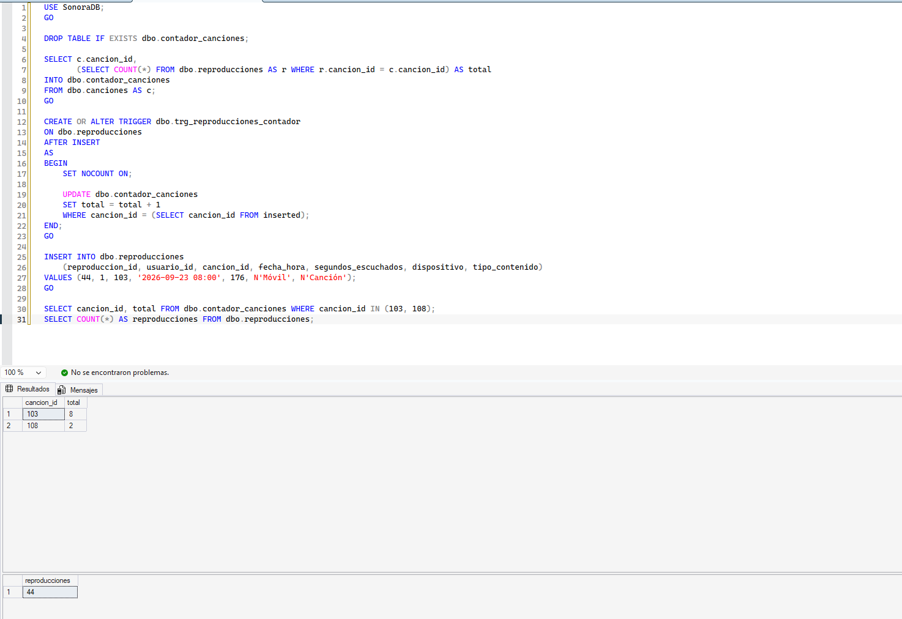

*Figura 28. Apartado a): con una fila el trigger funciona y Perreo Lunar pasa de 7 a 8.*

En el apartado b) la subconsulta (SELECT cancion_id FROM inserted) devuelve cuatro valores y no se puede comparar con =, así que el trigger falla con el Msg 512. Como el trigger trabaja dentro de la transacción del INSERT, el error deshace también el INSERT: no entra ninguna de las cuatro filas y la tabla sigue con 44.

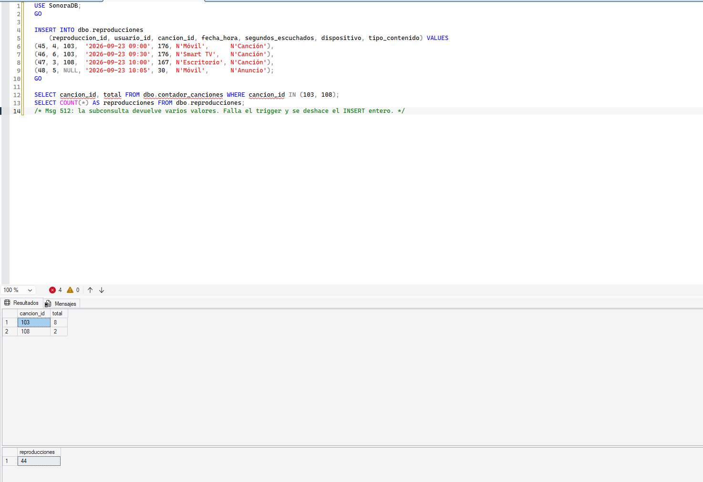

*Figura 29. Apartado b): el lote se rechaza entero y el contador no cambia.*

La versión corregida agrupa inserted por canción y suma el número de filas de cada una, sin contar las filas sin canción (el anuncio).

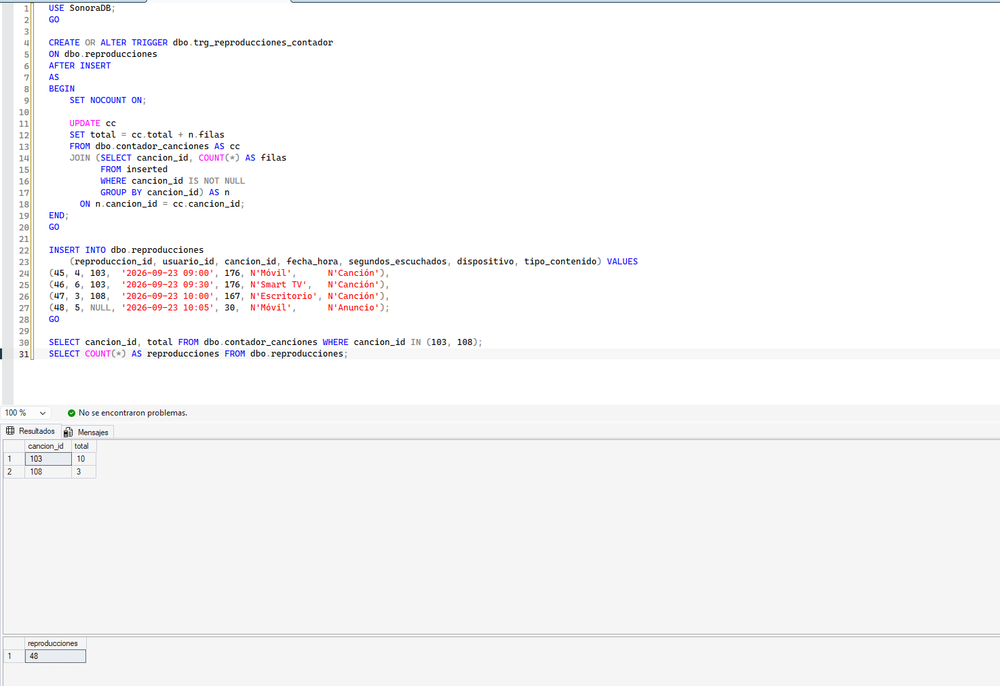

*Figura 30. Apartado c): la versión para conjuntos suma 2 a la canción 103 y 1 a la 108.*

Tras borrar las reproducciones de prueba, el contador marca 10 para Perreo Lunar, pero la canción tiene 7 reproducciones de verdad, y la 108 marca 3 cuando tiene 2. El trigger solo atiende a INSERT: los borrados no se restan, y tampoco se tendrían en cuenta los UPDATE que cambian cancion_id. Un total mantenido por trigger se descuadra en cuanto falta un caso, y el descuadre no se corrige solo. Para un resumen así es más fiable un procedimiento que lo recalcule desde la tabla de origen.

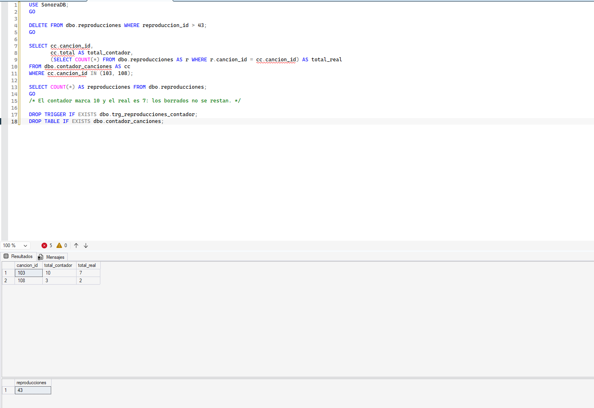

*Figura 31. Apartado d): contador frente a recuento real tras el borrado.*

### 3.6 Ejercicio 6. Auditoría de artistas con un único trigger

La operación se deduce del contenido de las tablas virtuales: si las dos tienen filas es un UPDATE, si solo inserted es un INSERT y si solo deleted es un DELETE. Si las dos están vacías, la instrucción no ha tocado ninguna fila y no se anota nada, que es lo que ocurre con el UPDATE del artista 999.

Script: `sql/sesion2_triggers/ej06_artistas_auditoria.sql`

```sql
USE SonoraDB;
GO

DROP TABLE IF EXISTS dbo.aud_artistas;

CREATE TABLE dbo.aud_artistas (
    auditoria_id  int IDENTITY(1,1) NOT NULL PRIMARY KEY,
    operacion     char(1)        NOT NULL CHECK (operacion IN ('I', 'U', 'D')),
    artista_id    int            NOT NULL,
    nombre        nvarchar(100)  NOT NULL,
    fecha         datetime2(0)   NOT NULL DEFAULT SYSDATETIME(),
    usuario_bd    nvarchar(128)  NOT NULL DEFAULT USER_NAME()
);
GO

CREATE OR ALTER TRIGGER dbo.trg_artistas_auditoria
ON dbo.artistas
AFTER INSERT, UPDATE, DELETE
AS
BEGIN
    SET NOCOUNT ON;

    IF EXISTS (SELECT 1 FROM inserted) AND EXISTS (SELECT 1 FROM deleted)
        INSERT INTO dbo.aud_artistas (operacion, artista_id, nombre)
        SELECT 'U', i.artista_id, i.nombre
        FROM inserted AS i;
    ELSE IF EXISTS (SELECT 1 FROM inserted)
        INSERT INTO dbo.aud_artistas (operacion, artista_id, nombre)
        SELECT 'I', i.artista_id, i.nombre
        FROM inserted AS i;
    ELSE IF EXISTS (SELECT 1 FROM deleted)
        INSERT INTO dbo.aud_artistas (operacion, artista_id, nombre)
        SELECT 'D', d.artista_id, d.nombre
        FROM deleted AS d;
    -- Si las dos están vacías, la instrucción no tocó ninguna fila: no se anota nada
END;
GO

INSERT INTO dbo.artistas (artista_id, nombre, pais, genero_id) VALUES
(10, N'Aurora Boreal',  'ES', 11),
(11, N'Trío Magnético', 'MX', 9);

UPDATE dbo.artistas SET nombre = N'Aurora Boreal & Cía' WHERE artista_id = 10;

UPDATE dbo.artistas SET pais = 'PT' WHERE artista_id = 999;

DELETE FROM dbo.artistas WHERE artista_id IN (10, 11);
GO

SELECT operacion, artista_id, nombre, fecha, usuario_bd
FROM dbo.aud_artistas
ORDER BY operacion, artista_id;
GO

DROP TRIGGER IF EXISTS dbo.trg_artistas_auditoria;
```

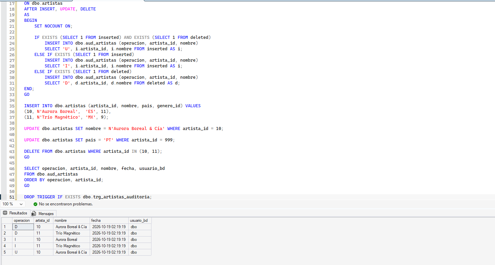

*Figura 32. Auditoría con dos altas, un cambio y dos bajas. El UPDATE sin filas no deja rastro.*

### 3.7 Ejercicio 7. Reproducciones anteriores al alta

Script: `sql/sesion2_triggers/ej07_reproducciones_fecha_alta.sql`

```sql
USE SonoraDB;
GO

CREATE OR ALTER TRIGGER dbo.trg_reproducciones_fecha_alta
ON dbo.reproducciones
AFTER INSERT
AS
BEGIN
    SET NOCOUNT ON;

    IF EXISTS (SELECT 1
               FROM inserted AS i
               JOIN dbo.usuarios AS u ON u.usuario_id = i.usuario_id
               WHERE i.fecha_hora < u.fecha_alta)
        THROW 50130, N'Hay reproducciones anteriores a la fecha de alta de su usuario.', 1;
END;
GO

-- a) pau.synth se dio de alta el 21/09  ->  Msg 50130
INSERT INTO dbo.reproducciones
    (reproduccion_id, usuario_id, cancion_id, fecha_hora, segundos_escuchados, dispositivo, tipo_contenido)
VALUES (44, 9, 103, '2026-09-20 10:00', 176, N'Web', N'Canción');
GO
SELECT COUNT(*) AS reproducciones FROM dbo.reproducciones;
GO

-- b) Una fila mala tumba a las dos buenas  ->  Msg 50130
INSERT INTO dbo.reproducciones
    (reproduccion_id, usuario_id, cancion_id, fecha_hora, segundos_escuchados, dispositivo, tipo_contenido) VALUES
(44, 6,  101, '2026-09-23 09:00', 185, N'Smart TV', N'Canción'),
(45, 10, 113, '2026-09-20 23:50', 158, N'Móvil',    N'Canción'),
(46, 2,  107, '2026-09-23 10:00', 198, N'Web',      N'Canción');
GO
SELECT COUNT(*) AS reproducciones FROM dbo.reproducciones;
GO

-- c) Solo las buenas  ->  (2 rows affected)
INSERT INTO dbo.reproducciones
    (reproduccion_id, usuario_id, cancion_id, fecha_hora, segundos_escuchados, dispositivo, tipo_contenido) VALUES
(44, 6,  101, '2026-09-23 09:00', 185, N'Smart TV', N'Canción'),
(46, 2,  107, '2026-09-23 10:00', 198, N'Web',      N'Canción');
GO
SELECT COUNT(*) AS reproducciones FROM dbo.reproducciones;
```

| Inserción | Resultado | Filas en reproducciones |
| --- | --- | --- |
| a) | Error Msg 50130 | 43 |
| b) | Error Msg 50130 | 43 |
| c) | 2 filas afectadas | 45 |

*Tabla 7. Resultado de las tres inserciones.*

En el apartado b) basta una fila incorrecta, la de kiara_perreo, para que el THROW deshaga la instrucción entera y las dos filas correctas tampoco entren. En c), sin esa fila, la inserción se completa.

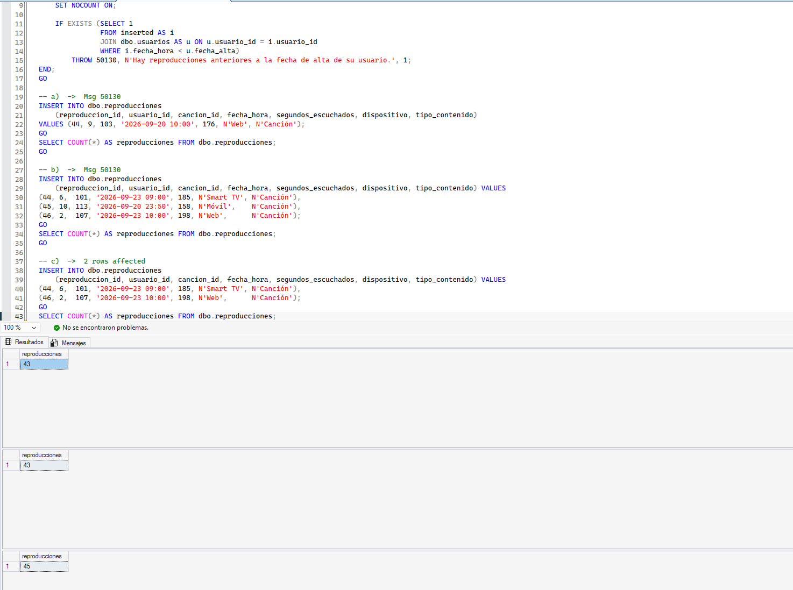

*Figura 33. Recuentos después de cada inserción: 43, 43 y 45.*

### 3.8 Ejercicio 8. ¿Restricción o trigger?

| Regla | Solución | Motivo |
| --- | --- | --- |
| a) Segundos no negativos | CHECK (segundos_escuchados >= 0) | Solo mira una columna de la propia fila. |
| b) Email único | UNIQUE (email) | Lo garantiza la propia restricción. |
| c) Artista existente | FOREIGN KEY (artista_id) | Integridad referencial. |
| d) No anterior al alta | Trigger | Compara con otra tabla, y un CHECK solo ve su fila. |
| e) Plan en una lista | CHECK (plan_suscripcion IN (...)) | Valores permitidos en una columna. |
| f) Anotar cambios de país | Trigger AFTER UPDATE | Una restricción no escribe en otra tabla. |
| g) Duración no baja más del 10 % | Trigger | Necesita el valor anterior, que solo está en deleted. |
| h) Título obligatorio | NOT NULL | Más un CHECK si tampoco se admite la cadena vacía. |

*Tabla 8. Cinco reglas con restricción y tres con trigger.*

### 3.9 Ejercicio 9. Hasta dónde llega el THROW de un trigger

Script: `sql/sesion2_triggers/ej09_alcance_del_rechazo.sql`

```sql
USE SonoraDB;
GO

BEGIN TRAN;

    INSERT INTO dbo.artistas (artista_id, nombre, pais, genero_id)
    VALUES (10, N'Aurora Boreal', 'ES', 11);

    INSERT INTO dbo.reproducciones
        (reproduccion_id, usuario_id, cancion_id, fecha_hora, segundos_escuchados, dispositivo, tipo_contenido)
    VALUES (47, 9, 103, '2026-09-20 10:00', 176, N'Web', N'Canción');

    INSERT INTO dbo.artistas (artista_id, nombre, pais, genero_id)
    VALUES (11, N'Trío Magnético', 'MX', 9);

COMMIT;
GO

SELECT @@TRANCOUNT AS transacciones_abiertas,
       (SELECT COUNT(*) FROM dbo.artistas) AS artistas;
GO

INSERT INTO dbo.artistas (artista_id, nombre, pais, genero_id)
VALUES (10, N'Aurora Boreal', 'ES', 11);

INSERT INTO dbo.reproducciones
    (reproduccion_id, usuario_id, cancion_id, fecha_hora, segundos_escuchados, dispositivo, tipo_contenido)
VALUES (47, 9, 103, '2026-09-20 10:00', 176, N'Web', N'Canción');

INSERT INTO dbo.artistas (artista_id, nombre, pais, genero_id)
VALUES (11, N'Trío Magnético', 'MX', 9);
GO

SELECT COUNT(*) AS artistas FROM dbo.artistas;
GO

DELETE FROM dbo.artistas WHERE artista_id > 9;
GO

BEGIN TRY
    INSERT INTO dbo.reproducciones
        (reproduccion_id, usuario_id, cancion_id, fecha_hora, segundos_escuchados, dispositivo, tipo_contenido)
    VALUES (47, 9, 103, '2026-09-20 10:00', 176, N'Web', N'Canción');
END TRY
BEGIN CATCH
    IF @@TRANCOUNT > 0 ROLLBACK;

    SELECT ERROR_NUMBER()    AS numero,
           ERROR_PROCEDURE() AS origen,
           ERROR_MESSAGE()   AS mensaje;
END CATCH;
```

En el apartado a), el INSERT de la reproducción 47 dispara el THROW del trigger. El error deshace la transacción completa, también el alta de Aurora Boreal, y termina el lote, así que ni el tercer INSERT ni el COMMIT llegan a ejecutarse. El SELECT del lote siguiente muestra 0 transacciones abiertas y 9 artistas.

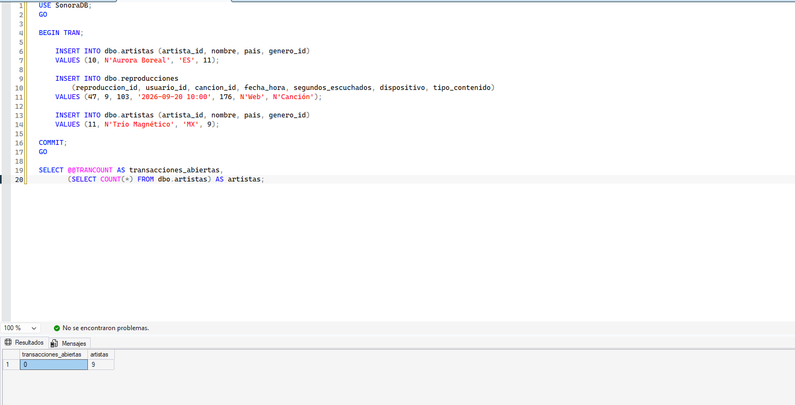

*Figura 34. Apartado a): sin transacciones abiertas y 9 artistas.*

En el apartado b), sin transacción explícita, el primer INSERT se confirma solo. El error del trigger deshace su propia instrucción y termina el lote, de modo que Trío Magnético no se inserta y quedan 10 artistas.

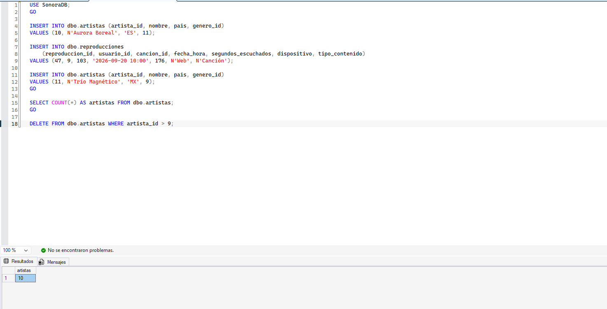

*Figura 35. Apartado b): 10 artistas, solo ha entrado Aurora Boreal.*

En el apartado c), el TRY ... CATCH recoge el error 50130. ERROR_PROCEDURE() devuelve el nombre del trigger sin el esquema, trg_reproducciones_fecha_alta, lo que confirma que el error se produce dentro del trigger y no en el INSERT.

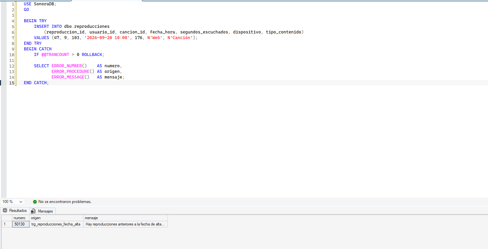

*Figura 36. Apartado c): número, origen y mensaje del error.*

### 3.10 Ejercicio 10. INSTEAD OF INSERT: ninguna fila tumba a las demás

Sin trigger, el CHECK rechaza Family y Premiun y la instrucción se anula entera, también la fila correcta de teo.bass (Msg 547 y 0 filas). El trigger INSTEAD OF sustituye al INSERT: corrige los planes, calcula el motivo de rechazo de cada fila en una tabla temporal, aparta las filas rechazadas e inserta el resto. Esa última escritura sobre la propia tabla no vuelve a disparar el trigger.

Script: `sql/sesion2_triggers/ej10_altas_web_instead_of.sql`

```sql
USE SonoraDB;
GO

DROP TABLE IF EXISTS dbo.altas_web;
DROP TABLE IF EXISTS dbo.altas_web_rechazadas;

CREATE TABLE dbo.altas_web (
    email             nvarchar(150)  NOT NULL PRIMARY KEY,
    pais              char(2)        NOT NULL,
    plan_suscripcion  nvarchar(20)   NOT NULL
        CHECK (plan_suscripcion IN (N'Free', N'Premium', N'Familiar')),
    fecha_registro    datetime2(0)   NOT NULL DEFAULT SYSDATETIME()
);

CREATE TABLE dbo.altas_web_rechazadas (
    email             nvarchar(150)  NULL,
    pais              char(2)        NULL,
    plan_suscripcion  nvarchar(20)   NULL,
    motivo            nvarchar(60)   NOT NULL,
    fecha             datetime2(0)   NOT NULL DEFAULT SYSDATETIME()
);
GO

INSERT INTO dbo.altas_web (email, pais, plan_suscripcion) VALUES
(N'teo.bass@mail.com',  'ES', N'Free'),
(N'ines.wave@mail.com', 'CO', N'Family'),
(N'rober.mx@mail.com',  'MX', N'Premiun');
GO

SELECT COUNT(*) AS filas_altas_web FROM dbo.altas_web;
GO

CREATE OR ALTER TRIGGER dbo.trg_altas_web_entrada
ON dbo.altas_web
INSTEAD OF INSERT
AS
BEGIN
    SET NOCOUNT ON;

    -- Lote con el plan corregido y el motivo de rechazo, en orden de controles
    SELECT x.email, x.pais, x.plan_suscripcion,
           CASE
               WHEN x.plan_suscripcion NOT IN (N'Free', N'Premium', N'Familiar')
                   THEN N'Plan no reconocido'
               WHEN EXISTS (SELECT 1 FROM dbo.altas_web AS a WHERE a.email = x.email)
                   THEN N'Email ya registrado'
           END AS motivo
    INTO #entrada
    FROM (
        SELECT i.email, i.pais,
               CASE i.plan_suscripcion
                   WHEN N'Family' THEN N'Familiar'
                   WHEN N'Gratis' THEN N'Free'
                   ELSE i.plan_suscripcion
               END AS plan_suscripcion
        FROM inserted AS i
    ) AS x;

    INSERT INTO dbo.altas_web_rechazadas (email, pais, plan_suscripcion, motivo)
    SELECT email, pais, plan_suscripcion, motivo
    FROM #entrada
    WHERE motivo IS NOT NULL;

    -- Esta escritura en la propia tabla no vuelve a disparar el trigger
    INSERT INTO dbo.altas_web (email, pais, plan_suscripcion)
    SELECT email, pais, plan_suscripcion
    FROM #entrada
    WHERE motivo IS NULL;
END;
GO

INSERT INTO dbo.altas_web (email, pais, plan_suscripcion) VALUES
(N'teo.bass@mail.com',  'ES', N'Free'),
(N'ines.wave@mail.com', 'CO', N'Family'),
(N'rober.mx@mail.com',  'MX', N'Premiun');
GO

INSERT INTO dbo.altas_web (email, pais, plan_suscripcion) VALUES
(N'teo.bass@mail.com', 'ES', N'Premium'),
(N'lola.pop@mail.com', 'ES', N'Gratis');
GO

SELECT email, pais, plan_suscripcion
FROM dbo.altas_web
ORDER BY email;

SELECT email, pais, plan_suscripcion, motivo
FROM dbo.altas_web_rechazadas
ORDER BY email;
```

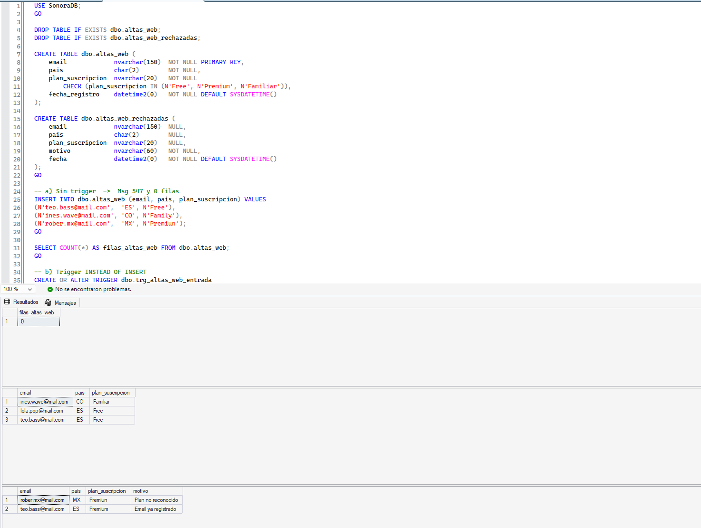

*Figura 37. 0 filas sin trigger, y después las dos tablas tras los dos lotes.*

Al repetir el primer lote entran teo.bass e ines.wave, esta con el plan corregido a Familiar, y rober.mx queda rechazado por Plan no reconocido. En el segundo lote entra lola.pop con Gratis corregido a Free, y teo.bass queda rechazado por Email ya registrado.

### 3.11 Ejercicio 11. Trigger DDL sobre vistas

Script: `sql/sesion2_triggers/ej11_ddl_vistas.sql`

```sql
USE SonoraDB;
GO

DROP TABLE IF EXISTS dbo.log_vistas;

CREATE TABLE dbo.log_vistas (
    cambio_id   int IDENTITY(1,1) NOT NULL PRIMARY KEY,
    fecha       datetime2(0)   NOT NULL DEFAULT SYSDATETIME(),
    usuario_bd  nvarchar(128)  NOT NULL DEFAULT USER_NAME(),
    evento      nvarchar(100)  NOT NULL,
    vista       nvarchar(128)  NULL
);
GO

CREATE OR ALTER TRIGGER trg_ddl_vistas
ON DATABASE
AFTER CREATE_VIEW, ALTER_VIEW, DROP_VIEW      -- equivale a DDL_VIEW_EVENTS
AS
BEGIN
    SET NOCOUNT ON;

    DECLARE @datos xml = EVENTDATA();

    INSERT INTO dbo.log_vistas (evento, vista)
    VALUES (@datos.value('(/EVENT_INSTANCE/EventType)[1]',  'nvarchar(100)'),
            @datos.value('(/EVENT_INSTANCE/ObjectName)[1]', 'nvarchar(128)'));
END;
GO

CREATE VIEW dbo.v_prueba_ddl
AS
SELECT usuario_id, nombre_usuario FROM dbo.usuarios;
GO

CREATE OR ALTER VIEW dbo.v_prueba_ddl
AS
SELECT usuario_id, nombre_usuario, pais FROM dbo.usuarios;
GO

DROP VIEW dbo.v_prueba_ddl;
GO

SELECT cambio_id, fecha, usuario_bd, evento, vista
FROM dbo.log_vistas
ORDER BY cambio_id;
GO

DROP TRIGGER IF EXISTS trg_ddl_vistas ON DATABASE;
```

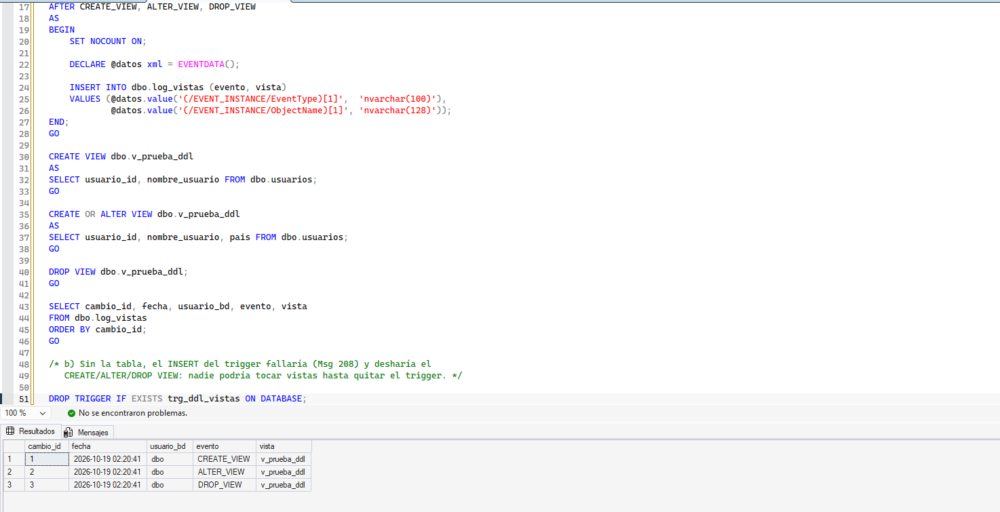

*Figura 38. log_vistas con la creación, la modificación y el borrado de la vista de prueba.*

Si alguien borrara dbo.log_vistas y dejara el trigger, este seguiría disparándose con cada CREATE, ALTER o DROP VIEW, pero su INSERT fallaría con el Msg 208, objeto no válido. El trigger trabaja dentro de la transacción de la instrucción DDL, así que el error la desharía: nadie podría crear, modificar ni borrar vistas en SonoraDB hasta recrear la tabla o borrar o desactivar el trigger.

### 3.12 Ejercicio 12. Carga histórica con el trigger desactivado

Script: `sql/sesion2_triggers/ej12_desactivar_trigger.sql`

```sql
USE SonoraDB;
GO

SELECT name, OBJECT_NAME(parent_id) AS sobre, is_instead_of_trigger, is_disabled
FROM sys.triggers
WHERE parent_id = OBJECT_ID(N'dbo.reproducciones');
GO

DISABLE TRIGGER dbo.trg_reproducciones_fecha_alta ON dbo.reproducciones;
GO

SELECT name, OBJECT_NAME(parent_id) AS sobre, is_disabled
FROM sys.triggers
WHERE name = N'trg_reproducciones_fecha_alta';
GO

INSERT INTO dbo.reproducciones
    (reproduccion_id, usuario_id, cancion_id, fecha_hora, segundos_escuchados, dispositivo, tipo_contenido) VALUES
(51, 6,  102, '2026-08-15 21:00', 201, N'Smart TV', N'Canción'),
(52, 10, 103, '2026-09-10 18:00', 176, N'Móvil',    N'Canción');
GO

ENABLE TRIGGER dbo.trg_reproducciones_fecha_alta ON dbo.reproducciones;
GO

SELECT name, OBJECT_NAME(parent_id) AS sobre, is_disabled
FROM sys.triggers
WHERE name = N'trg_reproducciones_fecha_alta';
GO
SELECT r.reproduccion_id, u.nombre_usuario, r.fecha_hora, u.fecha_alta
FROM dbo.reproducciones AS r
JOIN dbo.usuarios       AS u ON u.usuario_id = r.usuario_id
WHERE r.fecha_hora < u.fecha_alta
ORDER BY r.reproduccion_id;
GO

DELETE FROM dbo.reproducciones WHERE reproduccion_id > 43;
DROP TRIGGER IF EXISTS dbo.trg_reproducciones_fecha_alta;
```

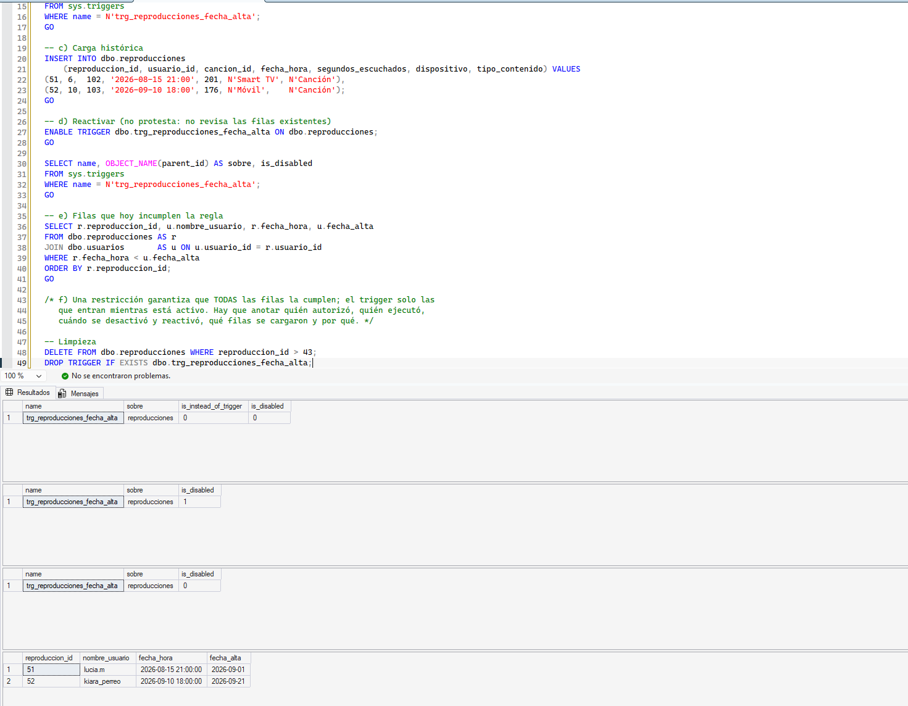

*Figura 39. Inventario, estado tras desactivar y reactivar, y filas que incumplen la regla.*

Al reactivar el trigger no hay ningún aviso: ENABLE TRIGGER no revisa las filas que ya están en la tabla, solo afecta a las inserciones que ocurran a partir de ese momento. La consulta del apartado e) devuelve las dos reproducciones históricas, de lucia.m y kiara_perreo, anteriores a sus fechas de alta.

Una restricción como CHECK o FOREIGN KEY garantiza que todas las filas de la tabla la cumplen, porque al crearla o reactivarla con WITH CHECK también comprueba las existentes. El trigger solo garantiza que la cumplen las filas que entran mientras está activo, y lo que entró con él desactivado se queda. Después de un mantenimiento así debería quedar anotado quién lo autorizó (Raúl), quién lo ejecutó, cuándo se desactivó y se reactivó el trigger, qué filas se cargaron (51 y 52) y el motivo, para que nadie las tome más adelante por un fallo del trigger. También conviene comprobar en sys.triggers que is_disabled ha vuelto a 0.

## 4. Incidencias durante la ejecución

- Ejercicio 3 de la Sesión 1. En el primer intento ejecuté las cinco llamadas a la vez y solo apareció el Msg 119. Es un error de compilación, así que SQL Server rechaza el lote completo antes de ejecutar nada. Las repetí de una en una.
- Ejercicio 10 de la Sesión 1. Al repetir los apartados c) y d) sin haber ejecutado antes el punto de partida, pau.synth no existía y el procedimiento respondió con el error 50020. Era la validación del apartado c) funcionando como se pide. Comprobé que el usuario seguía en dbo.stg_usuarios, lo recuperé junto con sus dos reproducciones del lote del 22/09 (43 reproducciones y 10 usuarios) y repetí los dos apartados.
- Ejercicio 13 de la Sesión 1. Por el mismo motivo, la primera ejecución terminó con 13 usuarios en lugar de 14. La repetí con pau.synth ya recuperado.
- Ejercicio 4 de la Sesión 2. La primera captura conservaba en Resultados la salida del ejercicio anterior. Volví a ejecutar el script, que se puede repetir porque recrea la tabla y restaura la plantilla.
